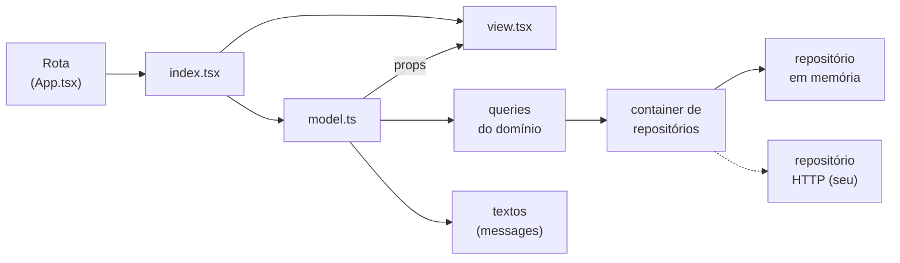

# Prumo

[](https://www.npmjs.com/package/@matizze/prumo-cli)
[](https://nodejs.org)
[](https://pnpm.io)

**Prumo cria e mantém aplicações React organizadas em camadas.** Ele gera a estrutura (telas, domínios de dados, componentes, textos em dois idiomas e testes) e confere a arquitetura a cada mudança, no terminal, no editor e para agentes de IA.

O Prumo **não tem frontend**. Ele não traz componente de interface, ícone, tema, CSS nem Storybook: o código que ele gera usa só React e HTML semântico, e a interface é do seu produto, com o design system que você escolher.

```bash
pnpm dlx @matizze/prumo-cli new meu-app
cd meu-app
pnpm exec prumo make:domain clientes
pnpm exec prumo make:page clientes --domain clientes
pnpm verify
```

Em menos de um minuto, você tem um app com Vite, React 19, TypeScript, TanStack Query, zod e i18next, uma tela que lista clientes de um repositório em memória, o teste de contrato desse repositório, os textos em português e inglês e uma verificação que cobra a arquitetura.

---

## Sumário

- [Por que o Prumo](#por-que-o-prumo)
- [Começando](#começando)
- [A arquitetura](#a-arquitetura)
- [Comandos](#comandos)
- [Pacotes](#pacotes)
- [Documentação](#documentação)
- [Situação do projeto](#situação-do-projeto)
- [Contribuindo](#contribuindo)

## Por que o Prumo

Todo time de frontend combina uma arquitetura e, poucos meses depois, encontra uma tela que busca dado direto na view, um componente "compartilhado" que só uma tela usa e um texto que existe em português e falta em inglês. O combinado vive num documento que ninguém relê.

O Prumo transforma o combinado em ferramenta:

- **Gera do jeito certo.** `make:page`, `make:domain` e `make:component` criam os arquivos a partir de modelos e fazem os registros (rota, textos, índices, container de repositórios). Ninguém copia uma tela antiga para começar outra.
- **Confere sempre.** Um plugin de ESLint avisa no editor, e o `prumo check` analisa o projeto inteiro: estrutura das telas, imports entre telas, uso real dos componentes compartilhados e textos completos em todos os idiomas.
- **Não amarra a interface.** As camadas de dados, textos e testes são as mesmas com qualquer design system. Trocar de biblioteca visual não muda a arquitetura.
- **Fala com agentes de IA.** O servidor MCP expõe os mesmos comandos como ferramentas, e cada app novo já vem com o `.mcp.json` e um `AGENTS.md`. O agente gera com os mesmos modelos e passa pela mesma verificação que uma pessoa.

## Começando

Requisitos: **Node.js 24** ou mais novo e **pnpm 10** ou mais novo. Os pacotes estão no npm público, sem token nem configuração.

```bash
pnpm dlx @matizze/prumo-cli new meu-app   # cria o app, roda git init e pnpm install
cd meu-app
pnpm dev                                  # http://localhost:5173
```

O passo a passo completo, do app vazio a uma tela com dados, textos e testes, está em [Primeiros passos](docs/getting-started.md).

## A arquitetura

```text
src/
  pages/<tela>/
    index.tsx          liga a rota ao model e à view
    model.ts           dados, textos e ações da tela, sem JSX
    view.tsx           apresentação: recebe tudo por props
    components/        componentes usados só por esta tela
  components/
    ui/                o design system do produto (seja qual for)
    shared/            componentes usados por duas ou mais telas
    layout/            a casca do app (cabeçalho, menu)
  schemas/entities/    schemas zod das entidades
  repositories/<domínio>/  contrato, implementação em memória e fixtures
  queries/<domínio>.ts     hooks de query e mutation (TanStack Query)
  messages/<idioma>/       textos por tela, em pt-BR e en
```



A view não busca dado nem guarda estado de dados; o model não tem JSX; uma tela não importa de outra; o dado chega por um repositório com contrato, nunca por um `fetch` solto. O porquê de cada regra está em [Arquitetura](docs/concepts/architecture.md).

## Comandos

| Comando                                               | O que faz                                                                                           |
| ----------------------------------------------------- | --------------------------------------------------------------------------------------------------- |
| `prumo new <nome>`                                    | Cria um app mínimo com a estrutura, os provedores, uma tela inicial, ESLint, Vitest e o `.mcp.json` |
| `prumo make:page <nome> [--domain <domínio>]`         | Gera a tela (index, model, view, teste), os textos nos idiomas do projeto e a rota                  |
| `prumo make:domain <nome> [--entity <singular>]`      | Gera schema, contrato, repositório em memória, fixtures, queries e o teste de contrato              |
| `prumo make:component <nome> (--page <tela> \| --shared)` | Gera um componente e o teste dele, na pasta da tela ou em `components/shared`                   |
| `prumo check`                                         | Analisa o projeto e lista as violações da arquitetura                                               |
| `prumo doctor`                                        | Confere Node, pnpm, a versão dos pacotes do Prumo e o `.mcp.json`                                   |

Os geradores validam tudo antes de escrever, nunca sobrescrevem um arquivo, aceitam `--dry-run` e rodam o `prumo check` no fim. Opções, saídas e códigos de saída estão na [referência da CLI](docs/reference/cli.md).

## Pacotes

| Pacote                                       | Versão                                                                                                         | O que entrega                                                                                     |
| -------------------------------------------- | -------------------------------------------------------------------------------------------------------------- | ------------------------------------------------------------------------------------------------- |
| [`@matizze/prumo-cli`](packages/cli)         | [](https://www.npmjs.com/package/@matizze/prumo-cli)         | O comando `prumo` e a API para rodar os comandos em processo                                      |
| [`@matizze/prumo-core`](packages/core)       | [](https://www.npmjs.com/package/@matizze/prumo-core)       | Container de repositórios, query keys, i18n tipado, erros com código, utilitários de mock e guarda de rota |
| [`@matizze/prumo-rules`](packages/rules)     | [](https://www.npmjs.com/package/@matizze/prumo-rules)     | O plugin de ESLint e a análise do projeto que o `prumo check` roda                                |
| [`@matizze/prumo-testing`](packages/testing) | [](https://www.npmjs.com/package/@matizze/prumo-testing) | `renderWithProviders` com rota em memória, setup do DOM e o teste de contrato de repositórios     |
| [`@matizze/prumo-mcp`](packages/mcp)         | [](https://www.npmjs.com/package/@matizze/prumo-mcp)         | O servidor MCP: os comandos da CLI como ferramentas para agentes de IA                            |

Os pacotes versionam separados. Um app criado pelo `prumo new` já tem os cinco.

## Documentação

A documentação completa está em [`docs/`](docs/README.md):

- **Tutorial:** [Primeiros passos](docs/getting-started.md)
- **Conceitos:** [Arquitetura](docs/concepts/architecture.md) e [Anatomia do app gerado](docs/concepts/generated-app.md)
- **Guias:** [telas](docs/guides/pages.md), [domínios de dados](docs/guides/domains.md), [ligar uma API real](docs/guides/real-api.md), [textos e idiomas](docs/guides/i18n.md), [erros e notificações](docs/guides/errors-and-notifications.md), [testes](docs/guides/test.md), [design system](docs/guides/design-system.md), [agentes de IA](docs/guides/ai-agents.md) e [projeto existente](docs/guides/existing-project.md)
- **Referência:** [CLI](docs/reference/cli.md), [core](docs/reference/core.md), [rules](docs/reference/rules.md), [testing](docs/reference/testing.md) e [MCP](docs/reference/mcp.md)
- [Perguntas frequentes e solução de problemas](docs/faq.md)

## Situação do projeto

O Prumo está em versão `0.x` e é mantido pela Matizze. A estrutura que ele gera é estável; a API dos pacotes ainda pode mudar entre versões menores, sempre registrada no `CHANGELOG.md` de cada pacote. O repositório é público para consulta, e o plano está em [docs/plan.md](docs/plan.md).

## Contribuindo

Como montar o ambiente, as verificações locais, as convenções e o fluxo de versão estão em [CONTRIBUTING.md](CONTRIBUTING.md). Para relatar uma vulnerabilidade, veja [SECURITY.md](SECURITY.md).
