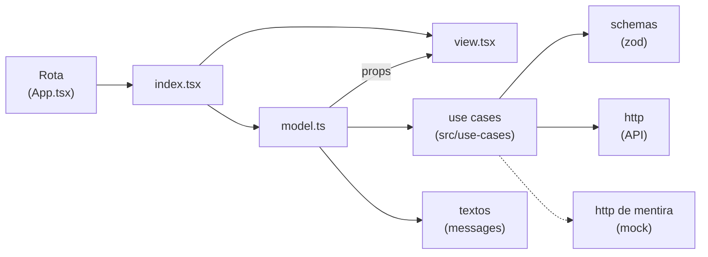

# Prumo

[](https://www.npmjs.com/package/@matizze/prumo-cli)
[](https://nodejs.org)
[](https://pnpm.io)
[](LICENSE)
[](https://docs.prumo.matizze.com.br)

**Prumo cria e mantém aplicações React organizadas em camadas.** Ele gera a estrutura (telas, use cases, schemas, textos em dois idiomas e testes) e confere a arquitetura a cada mudança, no terminal, no editor e para agentes de IA.

O Prumo **não tem frontend**. Ele não traz componente de interface, ícone, tema, CSS nem Storybook: o código que ele gera usa só React e HTML semântico, e a interface é do seu produto, com o design system que você escolher.

```bash
pnpm dlx @matizze/prumo-cli new meu-app
cd meu-app
pnpm exec prumo make:schema clientes --fields "nome:string,email:string"
pnpm exec prumo make:usecase clientes --crud
pnpm exec prumo make:usecase auth.sign-in --input "email:string,password:string" --output "token:string"
pnpm exec prumo make:page clientes --usecase clientes.list-clientes
pnpm exec prumo check
```

Em poucos minutos, você tem um app com Vite, React 19, TypeScript, TanStack Query, zod e i18next, uma tela que lista clientes por um use case rodando sobre um `http` de mentira (o mock, sem backend), o use case de entrar (`auth.sign-in`), o teste de cada use case, os textos em português e inglês e uma verificação que cobra a arquitetura. Para ligar a API de verdade, basta `VITE_DATA_SOURCE=http`.

Documentação completa: **[docs.prumo.matizze.com.br](https://docs.prumo.matizze.com.br)**.

---

## Sumário

- [Por que o Prumo](#por-que-o-prumo)
- [Começando](#começando)
- [A arquitetura](#a-arquitetura)
- [Comandos](#comandos)
- [Pacotes](#pacotes)
- [Documentação](#documentação)
- [Situação do projeto](#situação-do-projeto)
- [Contribuindo](#contribuindo)
- [Licença](#licença)

## Por que o Prumo

Todo time de frontend combina uma arquitetura e, poucos meses depois, encontra uma tela que busca dado direto na view, uma regra de negócio espalhada por três componentes e um texto que existe em português e falta em inglês. O combinado vive num documento que ninguém relê.

O Prumo transforma o combinado em ferramenta:

- **Gera do jeito certo.** `make:schema`, `make:usecase` e `make:page` criam, uma camada por comando, os arquivos a partir de modelos e fazem os registros (rota, textos, índices, registro de use cases). Ninguém copia uma tela antiga para começar outra.
- **Confere sempre.** Um plugin de ESLint avisa no editor, e o `prumo check` analisa o projeto inteiro: estrutura das telas, imports entre camadas, uso real dos componentes compartilhados e textos completos em todos os idiomas.
- **Não amarra a interface.** As camadas de dados, textos e testes são as mesmas com qualquer design system. Trocar de biblioteca visual não muda a arquitetura.

## Começando

Requisitos: **Node.js 24** ou mais novo e **pnpm 10** ou mais novo.

```bash
pnpm dlx @matizze/prumo-cli new meu-app   # cria o app, roda git init e pnpm install
cd meu-app
pnpm dev                                  # http://localhost:5173
```

O passo a passo completo, do app vazio a uma tela de lista, um formulário e o `pnpm verify`, está em [Primeiros passos](docs/getting-started.md).

## A arquitetura

Tudo o que o app faz com dados é um **use case**: uma ação com nome de verbo (`getStores`, `signIn`), uma entrada (Request), uma saída (Response), as duas validadas com zod, e um `execute`. As telas chamam use cases, e os use cases falam com a API.

| Camada    | Responde a                  | Pasta           |
| --------- | --------------------------- | --------------- |
| Interface | o que a pessoa vê e faz     | `src/pages`     |
| Domínio   | o que o app **faz**         | `src/use-cases` |
| Dados     | as **coisas** (entidades)   | `src/schemas`   |
| Infra     | como o app fala com o mundo | `src/http`      |



A regra entre as camadas é uma só: **cada uma usa a de baixo, e nada aponta para cima**. A view não busca dado; o model não tem JSX; uma tela não importa de outra nem de `src/http`; um use case não importa de tela, de React nem do TanStack. O `prumo check` e o ESLint conferem. O porquê de cada regra está em [Arquitetura](docs/concepts/architecture.md).

## Comandos

| Comando                                                                        | O que faz                                                                                          |
| ------------------------------------------------------------------------------ | -------------------------------------------------------------------------------------------------- |
| `prumo new <nome>`                                                             | Cria um app mínimo com a estrutura, os provedores, uma tela inicial, ESLint e Vitest               |
| `prumo make:schema <domínio> [--entity <singular>] [--fields <campos>]`        | Gera o schema zod da entidade, com os campos                                                       |
| `prumo make:usecase <domínio.ação> [--input <campos>] [--output <campos>] [--endpoint <rota>] [--local]` | Gera um use case (tipos, classe, rota de mock e teste), leitura ou escrita pelo verbo da ação, e o registra |
| `prumo make:usecase <domínio> --crud [--entity <singular>]`                  | Gera os cinco use cases do CRUD de uma entidade (list, get, create, update e remove), com uma coleção de mock que eles dividem |
| `prumo make:page <nome> [--usecase <domínio.ação>] [--path <caminho>]`         | Gera a tela (index, model, view, teste), os textos nos idiomas do projeto e a rota; com `--usecase`, lista, detalhe ou formulário |
| `prumo check`                                                                  | Analisa o projeto e lista as violações da arquitetura                                              |
| `prumo list [--json]`                                                          | Mostra o que o projeto tem: schemas, use cases, telas e idiomas (só lê)     |
| `prumo mcp`                                                                    | Abre o servidor MCP do projeto, por stdio, com uma ferramenta por comando, para agentes de IA      |

Cada camada usa a de baixo, então a ordem é schema, use case e tela; o comando recusa, sem criar nada, quando a camada de baixo falta. Os comandos que escrevem validam tudo antes, nunca sobrescrevem um arquivo e aceitam `--dry-run` (os `make:*`, o `check` e o `list` aceitam `--root`). Opções, saídas e códigos de saída estão na [referência da CLI](docs/reference/cli.md).

## Pacotes

| Pacote                                       | Versão                                                                                                         | O que entrega                                                                                     |
| -------------------------------------------- | -------------------------------------------------------------------------------------------------------------- | ------------------------------------------------------------------------------------------------- |
| [`@matizze/prumo-cli`](packages/cli)         | [](https://www.npmjs.com/package/@matizze/prumo-cli)         | O comando `prumo`: `new`, `make:*`, `check`, `list` e `mcp`                                      |
| [`@matizze/prumo-core`](packages/core)       | [](https://www.npmjs.com/package/@matizze/prumo-core)       | Cliente HTTP e mock por rota, use cases, query keys, i18n tipado, erros com código, utilitários de mock e guarda de rota |
| [`@matizze/prumo-rules`](packages/rules)     | [](https://www.npmjs.com/package/@matizze/prumo-rules)     | O plugin de ESLint e a análise do projeto que o `prumo check` roda                                |
| [`@matizze/prumo-testing`](packages/testing) | [](https://www.npmjs.com/package/@matizze/prumo-testing) | `renderWithProviders` com rota em memória, setup do DOM e o teste de contrato de use cases     |

Os pacotes versionam separados. Um app criado pelo `prumo new` já tem os quatro.

## Documentação

A documentação completa está em [docs.prumo.matizze.com.br](https://docs.prumo.matizze.com.br) (os mesmos arquivos de [`docs/`](docs/README.md)):

- **Tutorial:** [Primeiros passos](docs/getting-started.md)
- **Conceitos:** [Arquitetura](docs/concepts/architecture.md) e [Anatomia do app gerado](docs/concepts/generated-app.md)
- **Guias:** [telas](docs/guides/pages.md), [use cases](docs/guides/use-cases.md), [ligar uma API real](docs/guides/real-api.md), [login e sessão](docs/guides/auth.md), [textos e idiomas](docs/guides/i18n.md), [erros e notificações](docs/guides/errors-and-notifications.md), [testes](docs/guides/test.md), [design system](docs/guides/design-system.md), [agentes de IA](docs/guides/ai-agents.md) e [projeto existente](docs/guides/existing-project.md)
- **Referência:** [CLI](docs/reference/cli.md), [core](docs/reference/core.md), [rules](docs/reference/rules.md), [testing](docs/reference/testing.md)
- [Perguntas frequentes e solução de problemas](docs/faq.md) e o [roadmap](docs/roadmap.md)

## Situação do projeto

O Prumo está em versão `0.x` e é mantido pela Matizze. A estrutura que ele gera é estável; a API dos pacotes ainda pode mudar entre versões menores (a troca do repository pelo use case, por exemplo, tem um [guia de migração](docs/guides/migrate-to-use-cases.md)). O que vem depois está no [roadmap](docs/roadmap.md).

## Contribuindo

Como montar o ambiente, as verificações locais, as convenções e o fluxo de versão estão em [CONTRIBUTING.md](CONTRIBUTING.md). Para relatar uma vulnerabilidade, veja [SECURITY.md](SECURITY.md).

## Licença

[MIT](LICENSE), © 2026 Matizze.
