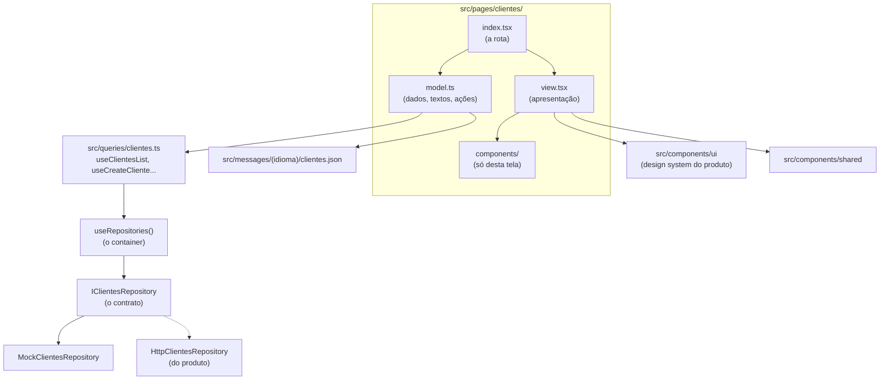

# Arquitetura

Este documento explica como um app do Prumo é organizado, as regras que o Prumo cobra e o motivo de cada uma. Ele vale para quem vai escrever código num app do Prumo e para quem precisa decidir se a arquitetura serve ao seu produto.

## O princípio

Um app React cresce por telas, e cada tela mistura três assuntos: **de onde vêm os dados**, **o que a tela diz** e **como ela aparece**. Quando os três ficam no mesmo arquivo, mudar um deles exige entender os outros dois, e trocar a biblioteca visual vira reescrever o app.

O Prumo separa os três em camadas com fronteiras que uma ferramenta consegue verificar:

| Assunto                  | Onde mora                                                          | Quem conhece                     |
| ------------------------ | ------------------------------------------------------------------ | -------------------------------- |
| De onde vêm os dados     | `schemas/`, `repositories/`, `queries/`                            | O model da tela                  |
| O que a tela diz         | `messages/<idioma>/<tela>.json`                                    | O model da tela                  |
| Como a tela aparece      | `view.tsx` e os componentes                                        | Só a view                        |

A **view** não conhece nenhuma das duas primeiras camadas: recebe tudo do model por props. Por isso o Prumo pode gerar views só com HTML semântico e deixar a interface inteira para o produto.

## As camadas

### Telas (`src/pages/<tela>/`)

Uma tela é a primeira pasta, a partir de `src/pages`, que tem `index.tsx`, e toda tela tem três arquivos:

- **`index.tsx`** é o ponto de entrada da rota. Chama o model e entrega o resultado à view. Não tem lógica.
- **`model.ts`** é um hook (`use<Tela>Model`) que reúne o que a tela precisa: os dados (pelas queries do domínio), os textos (pelo `useTranslations`), o estado da interação e as ações. Não tem JSX.
- **`view.tsx`** é a apresentação. Recebe o model inteiro por props, cujo tipo é `ReturnType<typeof use<Tela>Model>`, e não busca dado, não traduz texto e não guarda estado de dados.

Componentes que só essa tela usa ficam em `components/`, dentro da pasta dela. As subpastas de uma tela (`components/`, por exemplo, mesmo com um `index.tsx`) são parte dela e nunca viram tela.

As telas podem ser agrupadas em subpastas (`prumo make:page auth.login` cria `src/pages/auth/login/`). A pasta sem `index.tsx` (`auth`) só agrupa; a tela é `auth/login`, com a rota `/auth/login` e o componente `AuthLoginPage`. Uma tela não contém outra: `auth/login` não existe se `auth` já é tela.

O tipo da view vem do model, então acrescentar um campo no model o torna disponível na view com o tipo certo, e remover um campo que a view usa é erro de compilação.

### Componentes (`src/components/`)

A pasta de componentes tem só três subpastas, cada uma com um papel:

| Pasta     | O que guarda                                                                                       |
| --------- | -------------------------------------------------------------------------------------------------- |
| `ui/`     | O design system do produto: botões, campos, tabelas. O Prumo não olha o conteúdo, só o nome da pasta. |
| `shared/` | Componentes do produto usados por **duas ou mais** telas.                                          |
| `layout/` | A casca do app: cabeçalho, menu, rodapé. Aparece em todas as telas.                                |

Um componente que só uma tela usa não é compartilhado: mora na pasta da tela. Assim o `shared` não vira uma gaveta de tudo, e apagar uma tela leva junto o que era só dela. Quando uma segunda tela passa a usar o componente, você move o arquivo para o `shared` e acerta os imports (componentes do produto se criam à mão, e o `prumo check` confere o lugar).

### Domínios de dados

Um domínio (clientes, pedidos, produtos) tem três partes, cada uma numa pasta:

- **Schema** (`src/schemas/entities/<entidade>.ts`): o schema zod da entidade e os tipos derivados dele (a entidade, a entrada de criar e editar, a consulta da lista). É a fonte da verdade sobre a forma do dado.
- **Repositório** (`src/repositories/<domínio>/`): o **contrato** (`IClientesRepository`, uma interface com `list`, `get`, `create`, `update` e `remove`), uma implementação em memória (`mock`) com fixtures e o teste do contrato. As outras fontes (`http`, `storage`) são outras classes que cumprem o mesmo contrato.
- **Queries** (`src/queries/<domínio>.ts`): as query keys, as queries e os hooks do TanStack Query. Os hooks pegam o repositório do container (`useRepositories()`), nunca de um import direto, e as mutations atualizam o cache do domínio (invalidam as queries afetadas).

O **container** (`src/repositories/index.ts`) é um mapa de fábricas: cada domínio registra uma função que cria o repositório dele. Os testes trocam um repositório pelo container, sem mock de módulo.

### Regras de negócio e operações entre domínios

O que não é CRUD de um domínio só tem lugar fixo por convenção (o Prumo não gera nem cobra): as **regras** são funções puras em `src/rules/` (recebem os dados e "hoje" como argumento), e as **operações que envolvem mais de um domínio** são mutations em `src/queries/<nome>.ts`, que pegam os repositórios do container, aplicam as regras e invalidam os domínios afetados. O model da tela usa as mesmas regras para ligar e desligar ações. Veja [Regras de negócio e operações entre domínios](../guides/domains.md#regras-de-negócio-e-operações-entre-domínios).

### Textos (`src/messages/<idioma>/`)

Cada tela tem um JSON por idioma, com o mesmo nome da tela. O `index.ts` de cada idioma registra os JSONs como namespaces, e o `useTranslations('<tela>')` devolve um tradutor tipado pelas chaves do idioma padrão. As mensagens usam ICU, então plural e gênero ficam no texto, não no código.

### Provedores e infraestrutura

`src/providers/` reúne o que envolve o app: o `QueryClient` (com o tratamento global de erro), o i18n, o provedor de repositórios e, se o app tem login, a sessão (`src/providers/session/`, veja [Sessão e login](../guides/auth.md)). A infraestrutura vem do `@matizze/prumo-core`, e o app guarda só a configuração: quais idiomas, quais fontes de dados, como notificar um erro.

## As regras

O Prumo cobra a arquitetura em dois lugares. O **plugin de ESLint** olha um arquivo de cada vez e avisa no editor enquanto você escreve. O **`prumo check`** olha o projeto inteiro e cobre o que um arquivo sozinho não mostra. Os dois rodam no `pnpm verify`.

| Regra                         | Onde                  | O que cobra                                                                                     |
| ----------------------------- | --------------------- | ----------------------------------------------------------------------------------------------- |
| `prumo/no-cross-page-import`  | ESLint                | Uma tela não importa da pasta de outra tela, nem pelo alias nem por caminho relativo            |
| `prumo/page-structure`        | ESLint                | O `index.tsx` de uma tela tem `model.ts` e `view.tsx` ao lado                                   |
| `page-structure`              | `prumo check`         | Toda tela de `src/pages`, em qualquer profundidade, tem `index.tsx`, `model.ts` e `view.tsx`     |
| `components-folders`          | `prumo check`         | `src/components` só tem as subpastas `ui`, `shared` e `layout`                                  |
| `shared-usage`                | `prumo check`         | O que está em `components/shared` é usado por duas ou mais telas                                |
| `messages`                    | `prumo check`         | Os idiomas têm as mesmas chaves, os mesmos argumentos ICU, nenhum texto vazio e os mesmos namespaces registrados |

### Por que cada regra existe

**Telas não importam umas das outras.** Uma tela que importa de outra cria uma dependência invisível: mudar a view da tela A quebra a tela B, e apagar a tela A fica impossível. O que duas telas usam é, por definição, compartilhado, e vai para `components/shared`.

**Toda tela tem model e view.** A estrutura fixa faz qualquer tela ser lida do mesmo jeito, por uma pessoa ou por um agente. E a view separada é o que permite trocar a interface sem tocar nos dados.

**`components` tem só três pastas.** Sem limite, a pasta de componentes cresce em categorias (`widgets`, `common`, `misc`) que ninguém sabe onde começam. Com três papéis claros, cada componente tem um único lugar certo.

**`shared` é de fato compartilhado.** Um componente "compartilhado" que só uma tela usa engana quem lê e sobrevive à tela que o usava. O `prumo check` conta o uso pelo grafo de imports: um módulo de `shared` usado por outro módulo de `shared` vale pelas telas que usam esse outro, a casca do layout conta como duas telas (ela aparece em todas), e testes não contam como uso.

**Os textos estão completos em todos os idiomas.** A chave que falta em inglês só aparece quando alguém abre a tela em inglês, quase sempre em produção. O `prumo check` compara os idiomas a cada verificação: as chaves, os argumentos de cada mensagem (um `{count}` em português precisa existir em inglês) e o registro de cada namespace no `index.ts` do idioma.

A referência completa das regras, com as opções e as mensagens, está em [rules](../reference/rules.md).

## Convenções que os geradores seguem

Algumas convenções não são cobradas por regra, mas o código gerado as segue:

- **O dado vem de um hook de `src/queries`**, que usa o repositório do container. Nada de `fetch` solto numa tela.
- **Todo texto visível mora em `src/messages`**, nos dois idiomas, e é lido pelo `useTranslations`.
- **O repositório não conhece idioma.** Ele lança `UIError` com um código estável (`CLIENTE_NOT_FOUND`), e a interface traduz o código. Veja [Erros e notificações](../guides/errors-and-notifications.md).
- **Nomes em kebab-case** para telas, domínios e componentes (`pedidos-recentes`). O Prumo deriva o resto: `PedidosRecentesPage`, `usePedidosRecentesModel`, o namespace `pedidosRecentes`, a rota `/pedidos-recentes`.
- **Todo comportamento novo tem teste.** Cada comando que gera código (`make:repository`, `make:page`) cria o teste do que gerou.

## O que fica de fora

O Prumo decide **onde** cada coisa mora e **como** as camadas se falam. Ele não decide:

- **A interface.** Nenhum componente visual, ícone, tema, token ou CSS. Use o design system que quiser em `src/components/ui`.
- **A API e a autenticação.** O Prumo gera o contrato, um repositório `mock` (em memória) e, se você pedir com `--data-source`, as fontes `storage` e `http` (o `fetch` num cliente simples, com o formato da API que o app espera); a sessão e a API em si são do produto (os guias [Ligar uma API real](../guides/real-api.md) e [Sessão e login](../guides/auth.md) mostram um jeito).
- **As regras de negócio.** O Prumo diz onde elas moram (`src/rules/`), não quais são.
- **O estado global de interface.** Estado de tela fica no model; se o produto precisar de um store global, é escolha dele.

O critério para decidir se algo é do Prumo: **se a peça só faz sentido com uma interface específica, ela não é do Prumo.**

## Stack

| Peça                | Biblioteca                                                    |
| ------------------- | ------------------------------------------------------------- |
| Build e servidor    | Vite                                                          |
| Interface           | React 19                                                      |
| Linguagem           | TypeScript (estrito)                                          |
| Rotas               | wouter                                                        |
| Dados assíncronos   | TanStack Query 5                                              |
| Validação           | zod 4                                                         |
| Textos              | i18next com ICU, pelo `defineI18n` do core                    |
| Testes              | Vitest com jsdom e Testing Library                            |
| Lint                | ESLint 10 com typescript-eslint e o plugin do Prumo           |
| Gerenciador         | pnpm                                                          |
