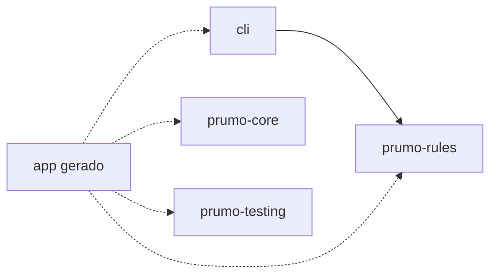

# Como o Prumo funciona por dentro

Este documento é para quem mantém os pacotes do Prumo: como o monorepo se organiza, como os comandos montam e aplicam as mudanças, como os modelos funcionam e como os pacotes são compilados, empacotados e publicados. Para o processo de contribuição (ambiente, verificação, versões), veja o [CONTRIBUTING.md](../../CONTRIBUTING.md).

## O monorepo

```text
packages/
  core/      @matizze/prumo-core     infraestrutura sem interface (navegador)
  rules/     @matizze/prumo-rules    plugin de ESLint e análise do projeto (Node)
  testing/   @matizze/prumo-testing  utilitários de teste (Vitest, jsdom)
  cli/       @matizze/prumo-cli      o comando prumo e os modelos (Node)
scripts/
  pack-packages.sh       compila e empacota os quatro pacotes (pnpm pack:all)
  publish-npm.sh         publica as versões que faltam no npm (workflow de publicação)
  rewrite-dts-imports.mjs  ajusta os imports .ts dos .d.ts compilados
.changeset/              as mudanças de versão pendentes
.github/workflows/       release.yml (publicação no npm) e docs.yml (o site)
```

As dependências entre pacotes:



O `core` e o `testing` não dependem de nenhum outro pacote do Prumo: são bibliotecas do app. A CLI usa o `rules` para o `check`.

## Código-fonte no workspace, `dist/` no pacote

No workspace, o `exports` de cada pacote aponta para o código-fonte (`src/*.ts`), e o Node 24 executa TypeScript direto (type stripping). Assim os testes, o lint e o bin da CLI rodam sem compilar.

Fora do monorepo, o Node não faz type stripping dentro de `node_modules`. Por isso cada pacote tem um `tsconfig.build.json` e o script `build`, que emite o `dist/` com `.js` e `.d.ts` (sem testes, fixtures e arquivos de apoio), e o `publishConfig` troca `exports`, `types` e `bin` para o `dist/` na hora do `pnpm pack`. O `scripts/rewrite-dts-imports.mjs` ajusta os imports com extensão `.ts` nos `.d.ts`.

O tarball leva só o `dist/`, o `package.json` e o README (e, no cli, os `templates/`). O `packaging.test.ts` do cli confere isso: compila, empacota, confere o conteúdo dos tarballs e roda o `prumo` empacotado, fora do monorepo.

## A CLI

A CLI usa o [commander](https://github.com/tj/commander.js). Os comandos são `new`, `make:schema`, `make:usecase`, `make:page`, `check`, `list` e `mcp`; a referência de uso está em [Referência da CLI](../reference/cli.md).

```text
packages/cli/
  src/
    bin.ts          a entrada: roda o programa com o terminal e define o código de saída
    program.ts      o comando raiz, a ajuda e os erros em português, e a função run
    errors.ts       UsageError (saída 2, só `prumo: <mensagem>`) e ExitError (código próprio)
    io.ts           o que um comando recebe do mundo: cwd, out e err
    commands/       um arquivo por comando: argumentos, opções, chamada ao gerador e saída
    generators/     app, schema, usecase (e o `--crud`) e page: recebem as opções e devolvem um plano
    codemods/       as edições do app, com o ts-morph: rota, índices de schemas e de mensagens, registro dos use cases
    lib/            nomes, campos e leitor do schema, plano, modelos, versões e apoio
    test/           o apoio dos testes (fora do pacote publicado): pastas temporárias, exec, o app gerado e o projeto de compilação
  templates/        os modelos .tpl, com marcadores de nome
```

### `commands/`

Cada comando é um arquivo que exporta um `RegisterCommand` (recebe o programa e o `io`); o `commands/index.ts` lista todos, na ordem da ajuda, e o `program.ts` os registra. O comando fica fino: lê os argumentos, chama o gerador, escreve o resultado pelo `io` (o `shared.ts` traz o que os comandos repetem: as opções `--root` e `--dry-run` e o "Criados" e "Alterados") e, sem `--dry-run`, grava o plano. Um erro lançado como `UsageError` sai com 2 e escreve só `prumo: <mensagem>` (o erro de opção ou argumento, que o commander acha, traz também a linha de uso e o "Veja"); `ExitError` sai com o código dele; qualquer outro erro sai com 1, a mensagem e, só com `PRUMO_DEBUG=1`, a pilha. Cada comando termina a ajuda com `documentCommand` (`commands/help-text.ts`): os exemplos e o link da seção dele em `docs/reference/cli.md`; mude a ajuda e a referência juntas. Os comandos acham o projeto com `locateProject` (`lib/project.ts`), que sobe da pasta atual quando não há `--root`.

A função `run(argv, io)` devolve o código de saída e nunca encerra o processo; por baixo, `execute` devolve também o tipo de saída (`ok`, `usage`, `exit` ou `unexpected`), que o servidor MCP usa para separar a violação do `check` de um erro inesperado, sem ler o stderr. Os comandos nunca escrevem direto no terminal: é o `io` que deixa os testes rodarem sem subprocesso. O `bin.ts` é o único que usa `process.stdout`, `process.stderr` e `process.exitCode`. Os testes de cada comando (`commands/*.test.ts`) usam o apoio em `src/test/` (`makeProject` e `makeDir`, de `fs.ts`; `exec` e `captureIo`, de `run.ts`) e rodam o comando numa pasta temporária.

### `generators/` e o plano

O gerador não toca o disco: valida tudo (nome, entidade, campos, camada de baixo que falta, arquivo que já existe) e devolve um `ChangePlan`, de `lib/plan.ts`. O plano guarda, em memória, os arquivos a criar e os a alterar: os de código entram num `Project` do ts-morph sem tsconfig e sem sistema de arquivos, e os outros (o JSON de mensagens) numa lista à parte. Só o `commit()` escreve, e, se uma escrita falha, ele apaga os arquivos e as pastas que criou, devolve o conteúdo dos arquivos que alterou e relança o erro. O `summary()` é o que o `--dry-run` mostra. Todo erro de uso sai antes do primeiro byte gravado.

### `codemods/`

As edições de arquivos que já existem, feitas pela árvore de sintaxe e não por texto solto: `add-route` (a rota no `<Switch>` do `App.tsx`), `register-schema` (o índice de schemas), `register-use-case` (o registro dos use cases e das rotas de mock), `register-messages` (o namespace de cada idioma) e `messages` (os idiomas do projeto). Cada um recusa, com mensagem clara, o arquivo que não tem a forma esperada (os pontos de registro estão em [Anatomia do app gerado](../concepts/generated-app.md#pontos-de-registro)).

### `mcp/`

O servidor do `prumo mcp` (o comando fica em `commands/mcp.ts`, que só confere o projeto e carrega o resto por `import()`, para o SDK do MCP não pesar nos outros comandos). O `tools.ts` descreve uma ferramenta por comando a partir da árvore do commander (nome, descrição, esquema de entrada e a conversão da entrada em `argv`), sem depender do SDK; o `server.ts` registra as ferramentas, roda `run(argv, io)` em processo, na pasta do projeto, com a saída capturada e uma fila de chamadas; o `stdio.ts` liga o transporte e só volta quando o cliente fecha. Um comando novo vira ferramenta sem mudar nada aqui.

### `lib/`

- `names.ts`: o kebab, o PascalCase e o camelCase de um nome, o plural e o singular (`clientes` → `cliente`, com a recusa dos plurais ambíguos e das palavras reservadas) e o `--entity`.
- `fields/`: o `--fields` (`parse.ts`, `types.ts`), os valores de exemplo (`samples.ts`), a geração do código dos modelos (`generate.ts`) e o **leitor do schema** (`read.ts`, e `page-shape.ts` para o `make:page`), que lê com o ts-morph os campos de um `<entidade>.ts` gerado (o `z.object`, o `pick` do schema de entrada e a `SortKey`) para o `make:usecase --crud` e o `make:page`. Um campo fora dos tipos do `--fields` é erro de uso, com a linha.
- `plan.ts`: o `ChangePlan`, descrito acima.
- `route-elements.ts` e `ast.ts`: a leitura das rotas do `<Switch>` do `App.tsx` e dos literais de texto, que o `list` e os codemods compartilham.
- `templates.ts`: carrega um `.tpl` e troca os marcadores `{{nome}}` (um marcador sem valor é erro do modelo).
- `listing.ts`: o levantamento que o `prumo list` mostra (só lê o projeto).
- `paths.ts`: `displayPath`, o caminho relativo com `/` das mensagens.
- `project.ts`: acha o projeto (a pasta com `package.json` e `src`) e os caminhos que os comandos usam.
- `versions.ts`: as versões dos pacotes do Prumo que o `new` grava (`^<versão>`); o `versions.test.ts` falha quando um `package.json` de `packages/*` muda e este arquivo não acompanha.
- `pnpm.ts`, `process.ts` e `tarballs.ts`: o `pnpm install`, os subprocessos e os tarballs do `--packages`.

### Os testes

Cada gerador tem um teste unitário (`generators/*.test.ts`) e cada codemod também. O apoio dos testes mora em `packages/cli/src/test/`, fora do pacote publicado (o `tsconfig.build.json` exclui a pasta e o `packaging.test.ts` confere o tarball):

- `fs.ts`: pastas temporárias (`makeDir`, `makeProject`, `writeFiles`), todas apagadas quando os testes do arquivo terminam.
- `run.ts`: `exec`, que roda o prumo em processo, e `captureIo`, o `Io` que captura `stdout` e `stderr`.
- `app.ts`: `generatedApp()`, os arquivos do app que o `prumo new` gera, montados pelo próprio `generateApp` a partir dos modelos (sem `pnpm install`, `git init` nem rede). Os ajustes que os testes fazem sobre ele passam pelo `patchText`, que falha se o trecho sumiu do modelo.
- `fixture-project.ts`: `fixtureProject()` e `fixturePlan()`, o projeto em miniatura dos codemods: partes vêm do modelo (as opções, o container de repositórios e o `App.tsx`, com ajustes) e partes ficam em estados específicos que as costuras precisam encontrar (mensagens fora de ordem, índices de schemas e queries com estilos variados).
- `compile.ts`: o projeto dos testes de compilação.

Os testes de compilação (`generators/*.compile.test.ts`) vão além: o `test/compile.ts` grava o app gerado numa pasta temporária, com atalhos para as dependências que o monorepo já instala (nada é baixado), aplica o que o gerador planejou e roda o `tsc` e o `vitest` nesse projeto. É o que prova que o código gerado compila e que o teste de contrato passa, para as três fontes, contra os modelos reais. O `packaging.test.ts` confere o tarball (veja acima), e o `verify-new.test.ts` confere só a ligação do script do portão (o `package.json` da raiz, o arquivo executável e as etapas); os comandos dentro do script quem executa é o próprio `pnpm verify:new`.

### `verify:new`

O `scripts/verify-new.sh` (`pnpm verify:new`) é o portão do app novo: empacota os pacotes, cria um app com `prumo new --packages` numa pasta temporária fora do monorepo, roda nele todos os comandos (`make:schema` com campos de todos os tipos, `make:usecase` de leitura, de escrita, local e o `--crud`, e as variações do `make:page`, com título, parâmetro e as telas de use case, inclusive um domínio com dígito na entidade), o `prumo list` (texto e `--json`, que o script confere), a etapa MCP e o `pnpm verify` do app (typecheck, lint, `prumo check` e testes). A etapa MCP roda o `scripts/drive-mcp.mjs` da cli: um cliente do SDK (`@modelcontextprotocol/client`, devDependency da cli) abre o servidor pelo `.mcp.json` que o `new` criou, confere as cinco ferramentas e gera, só por elas, o domínio `autores` (os use cases do CRUD), dois use cases e as telas, com um `dry_run`, um erro de uso, o `check` e o `list`. O script não edita arquivo do app (só a CLI e o servidor MCP mudam o app): se o verify do app falha, o achado é dos modelos, dos comandos, do servidor ou dos pacotes. Pesa (instala dependências), então roda por uma vez, e deve rodar ao mudar os modelos, o `new`, qualquer `make:*` ou o servidor MCP.

## Publicação

O único workflow do repositório é o de publicação (`.github/workflows/release.yml`). A cada push na `main`, ele roda o `scripts/publish-npm.sh`:

1. Pergunta ao npm, sem instalar nada, quais versões dos quatro pacotes ainda não existem. Se nenhuma falta, termina em segundos.
2. Se falta alguma, instala as dependências, compila e empacota (o `pnpm pack` troca o `workspace:*` pela versão).
3. Publica só os tarballs que faltam, na ordem das dependências (`rules`, `core`, `testing`, `cli`).

A autenticação é pelo **Trusted Publishing** do npm (OIDC, com `id-token: write`): nenhum token fica guardado no repositório. As actions são fixadas por SHA. Para conferir o que sairia sem publicar: `scripts/publish-npm.sh --dry-run`.

## O site da documentação

A pasta `docs/` também é publicada como site, em [docs.prumo.matizze.com.br](https://docs.prumo.matizze.com.br), pelo Docusaurus em `website/`:

- **O conteúdo não é copiado:** o `website/docusaurus.config.ts` aponta o plugin de documentação para `../docs`, com `routeBasePath: '/'`.
- **Markdown comum:** `markdown.format: 'detect'` lê os `.md` como CommonMark, não MDX, então o texto pode ter `<nome>` e chaves. Os diagramas Mermaid saem do tema `@docusaurus/theme-mermaid`.
- **Links para fora de `docs/`:** o plugin de remark `website/src/remark/link-outside-docs.ts` troca o link relativo para um arquivo fora do site (o `CONTRIBUTING.md`, o `SECURITY.md`) pelo endereço do arquivo no GitHub.
- **Build estrito:** link, âncora ou link de Markdown quebrados fazem o build falhar.

O workflow `.github/workflows/docs.yml`, a cada push na `main` que muda `docs/` ou `website/`, gera a imagem (`website/Dockerfile`: o build do Docusaurus e um nginx), roda o teste de fumaça (`website/docker/smoke-test.sh`), envia para o `ghcr.io/matizze/prumo-docs` e chama o webhook do Portainer (secret `PORTAINER_WEBHOOK_DOCS`), que reinicia o serviço com a imagem nova.
