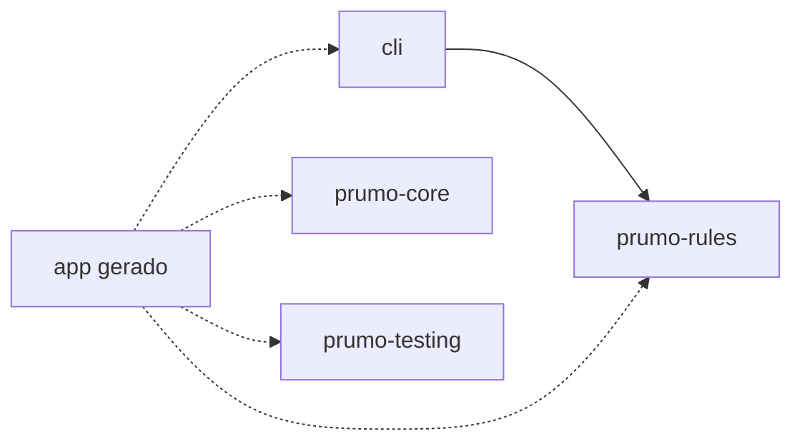

# Como o Prumo funciona por dentro

Este documento é para quem mantém os pacotes do Prumo: como o monorepo se organiza, como os geradores montam e aplicam as mudanças, como os modelos funcionam e como os pacotes são compilados, empacotados e publicados. Para o processo de contribuição (ambiente, verificação, versões), veja o [CONTRIBUTING.md](../../CONTRIBUTING.md).

## O monorepo

```text
packages/
  core/      @matizze/prumo-core     infraestrutura sem interface (navegador)
  rules/     @matizze/prumo-rules    plugin de ESLint e análise do projeto (Node)
  testing/   @matizze/prumo-testing  utilitários de teste (Vitest, jsdom)
  cli/       @matizze/prumo-cli      o comando prumo e os modelos (Node)
scripts/
  pack-packages.sh       compila e empacota os quatro pacotes (pnpm pack:all)
  publish-npm.sh         publica as versões que faltam no npm (workflow de publicação)
  rewrite-dts-imports.mjs  ajusta os imports .ts dos .d.ts compilados
.changeset/              as mudanças de versão pendentes
.github/workflows/release.yml  o único workflow: publicação
```

As dependências entre pacotes:



O `core` e o `testing` não dependem de nenhum outro pacote do Prumo: são bibliotecas do app. A CLI usa o `rules` para o `check`.

## Código-fonte no workspace, `dist/` no pacote

No workspace, o `exports` de cada pacote aponta para o código-fonte (`src/*.ts`), e o Node 24 executa TypeScript direto (type stripping). Assim os testes, o lint e o bin da CLI rodam sem compilar.

Fora do monorepo, o Node não faz type stripping dentro de `node_modules`. Por isso cada pacote tem um `tsconfig.build.json` e o script `build`, que emite o `dist/` com `.js` e `.d.ts` (sem testes, fixtures e arquivos de apoio), e o `publishConfig` troca `exports`, `types` e `bin` para o `dist/` na hora do `pnpm pack`. O `scripts/rewrite-dts-imports.mjs` ajusta os imports com extensão `.ts` nos `.d.ts`.

O tarball leva só o `dist/`, o `package.json` e o README (e, no cli, os `templates/`). O `packaging.test.ts` do cli confere isso: compila, empacota, confere o conteúdo dos tarballs e roda o `prumo` empacotado, fora do monorepo.

## A CLI

A CLI está em reescrita com o [commander](https://github.com/tj/commander.js), passo a passo (o plano está no `docs/plan.md` do repositório; ele fica fora do site). Hoje ela tem a base: ajuda, versão, erros e códigos de saída. Os comandos voltam nos próximos passos.

```text
packages/cli/src/
  bin.ts        a entrada: roda o programa com o terminal e define o código de saída
  program.ts    o comando raiz, a ajuda e os erros em português, e a função run
  errors.ts     ExitError (código próprio) e UsageError (saída 2, mostra a ajuda)
  commands/     um arquivo por comando
```

A função `run(argv, io)` devolve o código de saída e nunca encerra o processo. O `io` traz `cwd`, `out` e `err`: os comandos nunca escrevem direto no terminal, e é isso que deixa os testes rodarem sem subprocesso. O `bin.ts` é o único que usa `process.stdout`, `process.stderr` e `process.exitCode`.

Cada comando é um arquivo em `commands/` que exporta uma função `register` (recebe o programa e o `io`); o `program.ts` as chama. Um erro lançado como `UsageError` sai com 2 e a ajuda do comando; `ExitError` sai com o código dele; qualquer outro erro sai com 1 e a pilha.

## Os modelos (`templates/`)

Cada arquivo gerado sai de um modelo `.tpl` em `packages/cli/templates/`, com marcadores de nome. A extensão `.tpl` evita que o TypeScript, o ESLint e o Vitest tomem o modelo por código. Os modelos são reaproveitados pelos novos comandos, ajustados passo a passo.

## Publicação

O único workflow do repositório é o de publicação (`.github/workflows/release.yml`). A cada push na `main`, ele roda o `scripts/publish-npm.sh`:

1. Pergunta ao npm, sem instalar nada, quais versões dos quatro pacotes ainda não existem. Se nenhuma falta, termina em segundos.
2. Se falta alguma, instala as dependências, compila e empacota (o `pnpm pack` troca o `workspace:*` pela versão).
3. Publica só os tarballs que faltam, na ordem das dependências (`rules`, `core`, `testing`, `cli`).

A autenticação é pelo **Trusted Publishing** do npm (OIDC, com `id-token: write`): nenhum token fica guardado no repositório. As actions são fixadas por SHA. Para conferir o que sairia sem publicar: `scripts/publish-npm.sh --dry-run`.

## O site da documentação

A pasta `docs/` também é publicada como site, em [docs.prumo.matizze.com.br](https://docs.prumo.matizze.com.br), pelo Docusaurus em `website/`:

- **O conteúdo não é copiado:** o `website/docusaurus.config.ts` aponta o plugin de documentação para `../docs`, com `routeBasePath: '/'`. O `docs/plan.md` fica de fora do site.
- **Markdown comum:** `markdown.format: 'detect'` lê os `.md` como CommonMark, não MDX, então o texto pode ter `<nome>` e chaves. Os diagramas Mermaid saem do tema `@docusaurus/theme-mermaid`.
- **Links para fora de `docs/`:** o plugin de remark `website/src/remark/link-outside-docs.ts` troca o link relativo para um arquivo fora do site (o `CONTRIBUTING.md`, o plano) pelo endereço do arquivo no GitHub.
- **Build estrito:** link, âncora ou link de Markdown quebrados fazem o build falhar.

O workflow `.github/workflows/docs.yml`, a cada push na `main` que muda `docs/` ou `website/`, gera a imagem (`website/Dockerfile`: o build do Docusaurus e um nginx), roda o teste de fumaça (`website/docker/smoke-test.sh`), envia para o `ghcr.io/matizze/prumo-docs` e chama o webhook do Portainer (secret `PORTAINER_WEBHOOK_DOCS`), que reinicia o serviço com a imagem nova.
