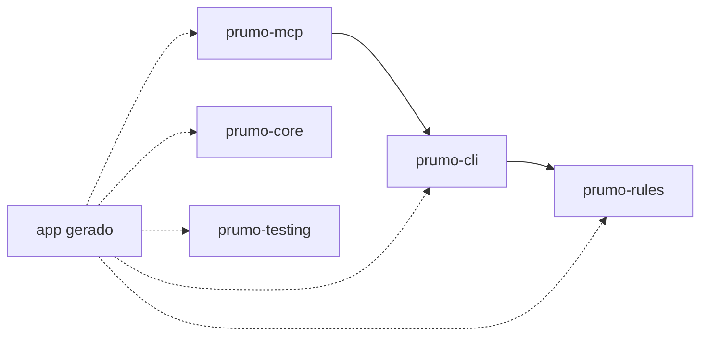

# Como o Prumo funciona por dentro

Este documento é para quem mantém os pacotes do Prumo: como o monorepo se organiza, como os geradores montam e aplicam as mudanças, como os modelos funcionam e como os pacotes são compilados, empacotados e publicados. Para o processo de contribuição (ambiente, verificação, versões), veja o [CONTRIBUTING.md](../../CONTRIBUTING.md).

## O monorepo

```text
packages/
  core/      @matizze/prumo-core     infraestrutura sem interface (navegador)
  rules/     @matizze/prumo-rules    plugin de ESLint e análise do projeto (Node)
  testing/   @matizze/prumo-testing  utilitários de teste (Vitest, jsdom)
  cli/       @matizze/prumo-cli      o comando prumo, os modelos e a API em processo (Node)
  mcp/       @matizze/prumo-mcp      o servidor MCP (Node)
scripts/
  pack-packages.sh       compila e empacota os cinco pacotes (pnpm pack:all)
  verify-new.sh          o portão do app novo (pnpm verify:new)
  publish-npm.sh         publica as versões que faltam no npm (workflow de publicação)
  rewrite-dts-imports.mjs  ajusta os imports .ts dos .d.ts compilados
.changeset/              as mudanças de versão pendentes
.github/workflows/release.yml  o único workflow: publicação
```

As dependências entre pacotes:



O `core` e o `testing` não dependem de nenhum outro pacote do Prumo: são bibliotecas do app. A CLI usa o `rules` para o `check`; o MCP usa a API em processo da CLI.

## Código-fonte no workspace, `dist/` no pacote

No workspace, o `exports` de cada pacote aponta para o código-fonte (`src/*.ts`), e o Node 24 executa TypeScript direto (type stripping). Assim os testes, o lint e o bin da CLI rodam sem compilar.

Fora do monorepo, o Node não faz type stripping dentro de `node_modules`. Por isso cada pacote tem um `tsconfig.build.json` e o script `build`, que emite o `dist/` com `.js` e `.d.ts` (sem testes, fixtures e arquivos de apoio), e o `publishConfig` troca `exports`, `types` e `bin` para o `dist/` na hora do `pnpm pack`. O `scripts/rewrite-dts-imports.mjs` ajusta os imports com extensão `.ts` nos `.d.ts`.

O tarball leva só o `dist/`, o `package.json` e o README (e, no cli, os `templates/`). O `packaging.test.ts` do cli confere isso: compila, empacota, confere o conteúdo dos tarballs, gera um domínio com o `prumo` empacotado fora do monorepo e sobe o `prumo-mcp` empacotado para um `initialize` e um `tools/list` por stdio.

## A CLI

### A árvore de comandos e o `Runtime`

Os comandos são definidos com o [citty](https://github.com/unjs/citty) em `src/commands/`, e a árvore é montada por `createRoot(runtime)` em `src/root.ts`. Um comando novo entra em `subCommands`.

Os comandos nunca escrevem direto no terminal: recebem um **`Runtime`** (`out`, `err`, `cwd`, `env` e `inheritStdio`). O `bin.ts` passa o terminal e o `process.cwd()`; os testes e o servidor MCP passam funções que capturam a saída e uma pasta qualquer. É isso que permite rodar um comando em processo (`runInProcess`) sem subprocesso e sem estado compartilhado.

**O stdout é do protocolo.** No transporte stdio do MCP, uma linha solta no stdout corromperia o JSON-RPC. O `no-leak.test.ts` proíbe `process.stdout`, `process.stderr`, `console.` e `stdio: 'inherit'` em todo o código da CLI, menos no `bin.ts` e no `process.ts` (que roda os subprocessos). Subprocessos (o `pnpm install` do `new`) só herdam o terminal com `inheritStdio`; sem ele, a saída é capturada e repassada ao `Runtime`.

### O executor e a ajuda

O `runMain` do citty não serve de porta de entrada: ele sai com 1 em qualquer erro e escreve em inglês. O `runCli` (`src/run.ts`) acha o comando, mostra a ajuda quando pedida (`src/help.ts`, em português), confere os argumentos (`src/args.ts`) e devolve o código de saída: `ExitError` carrega o código; `UsageError` é o 2 e vem com a ajuda do comando.

### Os geradores

Cada gerador (`src/generate/<nome>.ts`) monta um **`ChangePlan`** (`src/codemod/plan.ts`): um plano de mudanças em memória, sobre um `Project` do [ts-morph](https://ts-morph.com) sem tsconfig e sem checagem de tipos. O plano recebe os arquivos novos e as costuras (as edições nos pontos de registro), lista o que seria criado e alterado (`summary()`, o `--dry-run`) e só grava no `commit()`. Um erro em qualquer etapa lança antes do `commit`, e o projeto não fica pela metade.

Os comandos (`src/commands/make-*.ts`) chamam o gerador, mostram o resumo, fazem o `commit` e terminam com o `finishWithCheck` (`src/commands/shared.ts`), que roda o `prumo check`, separa as violações esperadas (o `shared-usage` de um componente compartilhado novo) e escreve o próximo passo.

### As costuras (`src/codemod/`)

| Arquivo                                   | O que faz                                                                                                   |
| ----------------------------------------- | ----------------------------------------------------------------------------------------------------------- |
| `names.ts`                                | Valida nomes (kebab-case, palavras reservadas, globais) e deriva Pascal, camel, singular e plural          |
| `add-route.ts`                            | Registra a rota no `<Switch>` mais externo do `App.tsx`, com o import na ordem dos de `@/pages`; recusa rota repetida ou conflitante |
| `register-messages.ts`, `messages.ts`     | Registra o namespace no `index.ts` de cada idioma, em ordem alfabética, também num índice vazio            |
| `register-domain.ts`                      | Registra o domínio em `src/schemas/index.ts`, `src/queries/index.ts` e no mapa `factories` de `src/repositories/index.ts` |
| `merge-barrel.ts`                         | Acrescenta a um barrel os exports de outro que faltam (exportado pelo codemod; nenhum gerador o usa hoje) |
| `edit.ts`, `route-elements.ts`            | Edições de texto sobre a árvore e utilitários de JSX                                                       |

As costuras editam pela árvore de sintaxe, preservando a formatação, as aspas e o ponto e vírgula do arquivo. Os testes montam um projeto pequeno numa pasta temporária (`src/codemod/test-support.ts`).

### Os modelos (`templates/`)

Os geradores não copiam código de outro projeto: cada arquivo gerado sai de um modelo `.tpl` em `packages/cli/templates/`, com marcadores de nome. A extensão `.tpl` evita que o TypeScript, o ESLint e o Vitest tomem o modelo por código.

```text
templates/
  app/        o app do prumo new
  page/       index, model, view, teste e mensagens (com e sem domínio)
  domain/     schema, contrato, mock, fixtures, índice, queries e teste de contrato
  component/  componente e teste
```

**Marcadores:** ``, com os grupos `page`, `domain`, `plural`, `singular`, `component` e `app`, e as formas `kebab`, `pascal`, `camel`, `constant` e `title` (o nome legível, que os modelos de tela usam no título). Para `pedidos-recentes`: `pedidos-recentes`, `PedidosRecentes`, `pedidosRecentes`, `PEDIDOS_RECENTES` e `Pedidos Recentes`. O `new` usa `{{app.title}}`. O nome do marcador só tem letras, números e ponto, então um `{{` de JSX não é marcador. Um marcador sem valor lança erro: o gerador nunca escreve `undefined`. A troca é feita por `renderTemplate` e os valores por `nameVars` (`src/templates.ts`).

**Caminhos:** cada gerador lista os pares modelo e destino, com o destino também com marcadores (`src/repositories/{{plural.kebab}}/index.ts`).

**Conferências:**

- o `templates.test.ts` confere que todo arquivo de `templates/` é usado por um gerador e que todo modelo citado existe;
- o `generate/page.compile.test.ts` monta um projeto como o do `prumo new`, gera um domínio, três telas e dois componentes e roda nele o `tsc` estrito, o Vitest e o `prumo check`;
- o `generate/domain.compile.test.ts` gera três domínios (um com nome composto e entidade explícita) e roda o `tsc` e o Vitest, com o contrato de cada mock;
- o portão `pnpm verify:new` cria um app de verdade e roda o `pnpm verify` dele.

### As versões do app novo

O `prumo new` grava `^<versão>` de cada pacote do Prumo a partir de `src/new/versions.ts`. O `versions.test.ts` compara o mapa com os `package.json` de `packages/*`: ao subir uma versão, o teste falha até o mapa acompanhar.

O `prumo doctor` compara as versões instaladas com faixas compatíveis em `src/doctor/ranges.ts`. O `ranges.test.ts` compara as faixas com as versões do workspace: quando um pacote sai da faixa (uma versão que quebra a compatibilidade), o teste falha e a faixa é revista.

## O servidor MCP

O servidor (`packages/mcp/src/`) não tem lógica de comando. O `server.ts` pede a árvore ao `describeCommands` e registra uma ferramenta por comando; o `schema.ts` deriva o esquema zod dos argumentos; o `tools.ts` converte a chamada em linha de comando (`toArgv`), roda em processo (`runInProcess`) e devolve o texto. As únicas regras próprias do servidor são a fila (uma chamada por vez) e a fronteira de pastas (`root` e `dir` dentro do `cwd`).

O `parity.test.ts` compara as ferramentas com a **ajuda** do `prumo` (e não com o `describeCommands`, que é a própria fonte), e o `bin.test.ts` sobe o servidor por stdio e confere que cada linha do stdout é JSON-RPC.

## O portão do app novo (`pnpm verify:new`)

O `scripts/verify-new.sh` prova de ponta a ponta o que o Prumo entrega, sem navegador e sem rede além do registry:

1. **pack:** compila e empacota os cinco pacotes (`pnpm pack:all`).
2. **new:** cria um app com `prumo new --packages <tarballs>` numa pasta temporária fora do monorepo.
3. **cli:** gera um domínio, uma tela com `--domain` e um componente pela CLI.
4. **mcp:** gera outro domínio, outra tela e outro componente só por ferramentas MCP, com um cliente de verdade por stdio (`packages/mcp/scripts/drive-mcp.mjs`) contra o `prumo-mcp` do app.
5. **verify:** roda o `pnpm verify` do app (typecheck, lint, `prumo check` e testes).
6. **clean:** apaga a pasta temporária, também em caso de falha.

O script nunca edita um arquivo do app: só a CLI e o MCP mudam o app. Se o verify do app falha, o defeito está nos modelos, na CLI ou nos pacotes.

## Publicação

O único workflow do repositório é o de publicação (`.github/workflows/release.yml`). A cada push na `main`, ele roda o `scripts/publish-npm.sh`:

1. Pergunta ao npm, sem instalar nada, quais versões dos cinco pacotes ainda não existem. Se nenhuma falta, termina em segundos.
2. Se falta alguma, instala as dependências, compila e empacota (o `pnpm pack` troca o `workspace:*` pela versão).
3. Publica só os tarballs que faltam, na ordem das dependências (`rules`, `core`, `testing`, `cli`, `mcp`).

A autenticação é pelo **Trusted Publishing** do npm (OIDC, com `id-token: write`): nenhum token fica guardado no repositório. As actions são fixadas por SHA. Para conferir o que sairia sem publicar: `scripts/publish-npm.sh --dry-run`.

## O site da documentação

A pasta `docs/` também é publicada como site, em [docs.prumo.matizze.com.br](https://docs.prumo.matizze.com.br), pelo Docusaurus em `website/`:

- **O conteúdo não é copiado:** o `website/docusaurus.config.ts` aponta o plugin de documentação para `../docs`, com `routeBasePath: '/'`. O `docs/plan.md` fica de fora do site.
- **Markdown comum:** `markdown.format: 'detect'` lê os `.md` como CommonMark, não MDX, então o texto pode ter `<nome>` e chaves. Os diagramas Mermaid saem do tema `@docusaurus/theme-mermaid`.
- **Links para fora de `docs/`:** o plugin de remark `website/src/remark/link-outside-docs.ts` troca o link relativo para um arquivo fora do site (o `CONTRIBUTING.md`, o plano) pelo endereço do arquivo no GitHub.
- **Build estrito:** link, âncora ou link de Markdown quebrados fazem o build falhar.

O workflow `.github/workflows/docs.yml`, a cada push na `main` que muda `docs/` ou `website/`, gera a imagem (`website/Dockerfile`: o build do Docusaurus e um nginx), roda o teste de fumaça (`website/docker/smoke-test.sh`), envia para o `ghcr.io/matizze/prumo-docs` e chama o webhook do Portainer (secret `PORTAINER_WEBHOOK_DOCS`), que reinicia o serviço com a imagem nova.
