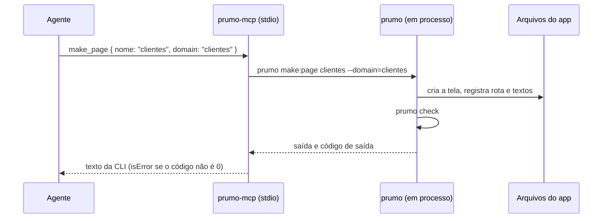

# Agentes de IA

O Prumo foi feito para ser usado tanto por pessoas quanto por agentes de IA. Todo app criado pelo `prumo new` já vem com dois arquivos para isso:

- **`.mcp.json`**, que liga o servidor MCP do Prumo ao agente. Com ele, os comandos da CLI viram ferramentas que o agente chama.
- **`AGENTS.md`**, o guia do projeto para agentes: as camadas, as regras, os comandos e o que fazer antes de dar uma tarefa por pronta.

Com os dois, o agente gera telas e domínios pelos mesmos modelos que uma pessoa usa, e passa pela mesma verificação.

## Como funciona



O servidor não tem lógica própria de comando: cada ferramenta é a projeção de um comando da CLI, com o nome, a descrição e os campos tirados da própria árvore de comandos. Um comando novo da CLI vira ferramenta sem mudar o servidor.

## Com o Claude Code

Abra o Claude Code na pasta do app (com o `CLAUDE.md` que importa o `AGENTS.md`, veja [O `AGENTS.md`](#o-agentsmd)). Ele lê o `.mcp.json` e pede para aprovar o servidor `prumo` do projeto. Depois disso, as ferramentas aparecem com o prefixo `mcp__prumo__`:

| Ferramenta                    | Comando                 |
| ----------------------------- | ----------------------- |
| `mcp__prumo__new`             | `prumo new`             |
| `mcp__prumo__make_page`       | `prumo make:page`       |
| `mcp__prumo__make_domain`     | `prumo make:domain`     |
| `mcp__prumo__make_component`  | `prumo make:component`  |
| `mcp__prumo__check`           | `prumo check`           |
| `mcp__prumo__doctor`          | `prumo doctor`          |

Um pedido como este já basta:

> Crie um domínio de pedidos com os campos número, valor e status, e uma tela que lista os pedidos com o valor formatado em reais. Rode o `pnpm verify` no fim.

O agente lê o `AGENTS.md`, gera o domínio e a tela pelas ferramentas, ajusta o schema, as fixtures, o contrato, o model, a view e os textos, e confere com o `pnpm verify`.

## Com outros clientes MCP

O servidor fala MCP por **stdio** e roda na pasta do projeto. Qualquer cliente que aceite um servidor stdio serve; a configuração é a mesma do `.mcp.json`:

```json
{
  "mcpServers": {
    "prumo": { "command": "pnpm", "args": ["exec", "prumo-mcp"] }
  }
}
```

Se o cliente não usa a pasta do projeto como diretório de trabalho, configure-a (o campo costuma se chamar `cwd`). O `prumo-mcp` é o bin do `@matizze/prumo-mcp`, que o app tem como dependência de desenvolvimento.

## As ferramentas

Os campos de cada ferramenta têm o nome do argumento na CLI:

| Ferramenta       | Campos                                             |
| ---------------- | -------------------------------------------------- |
| `new`            | `nome`, `dir`, `packages`, `install`, `dry-run`    |
| `make_page`      | `nome`, `domain`, `path`, `root`, `dry-run`        |
| `make_domain`    | `nome`, `entity`, `root`, `dry-run`                |
| `make_component` | `nome`, `page`, `shared`, `root`, `dry-run`        |
| `check`          | `root`                                             |
| `doctor`         | `root`                                             |

- **A resposta é o texto da CLI:** o stdout, depois o stderr e, quando o código de saída não é 0, uma última linha `[saída <código>]`. A ferramenta marca `isError` quando o código não é 0: violação do `check` (1) e uso errado (2) são erro, como no terminal.
- **Um campo que o comando não tem é recusado**, e um texto que começa com `-` também (a CLI o leria como opção).
- **Uma chamada de cada vez.** Se o agente pedir várias juntas, o servidor as enfileira: dois geradores escrevendo no mesmo `App.tsx` ao mesmo tempo se atropelariam.

A referência completa, com os esquemas e a API do servidor, está em [MCP](../reference/mcp.md).

## Segurança

O servidor roda com as permissões de quem o iniciou, e quem escolhe os campos é o agente. Por isso há uma regra que não vem da CLI: **`root` e `dir` precisam ficar dentro da pasta do servidor.** O servidor resolve os dois contra a pasta do projeto, seguindo links simbólicos, e recusa (com `isError`, sem rodar o comando) qualquer caminho que saia dela, como `root: "/"` ou `dir: "../outro"`.

O servidor não expõe resources nem prompts, não abre porta de rede (só stdio) e não executa nada além dos comandos do `prumo`. O `new` pelo servidor roda o `pnpm install`, e a saída dele volta no texto da ferramenta.

## O `AGENTS.md`

O `AGENTS.md` gerado é curto de propósito: as camadas, as quatro regras de convivência (telas isoladas, view sem dados, dado pelo repositório, texto nos dois idiomas), a tabela de comandos e as regras do projeto. Ele é do seu time: acrescente as convenções do produto (o design system, a API, o que exige aprovação).

Vários agentes leem o `AGENTS.md` da raiz do projeto por conta própria. O Claude Code lê o `CLAUDE.md`: crie um com a linha abaixo para que ele importe o `AGENTS.md` (é o que o próprio repositório do Prumo faz):

```markdown
@AGENTS.md
```

## Quando algo não funciona

- **O agente não vê as ferramentas.** Rode `pnpm exec prumo doctor`: ele confere se o `.mcp.json` existe, se é um JSON válido e se tem o servidor `prumo`, e mostra o trecho a acrescentar.
- **O servidor não sobe.** Confira se as dependências estão instaladas (`pnpm install`) e se `pnpm exec prumo-mcp --version` mostra a versão.
- **Não rode o `prumo-mcp` à mão** para testar comandos: o stdout dele é o protocolo. Para isso, use o `prumo` no terminal.
