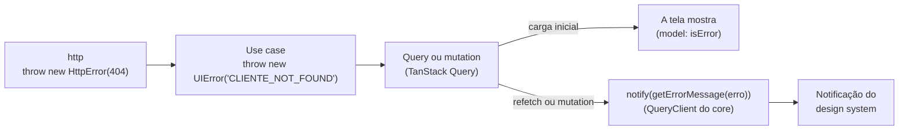

# Erros e notificações

Este guia mostra como um erro sai do use case e chega à pessoa no idioma certo: o `UIError` com código estável, a tradução do código, a notificação global do `QueryClient` e o controle por query ou mutation.

## O caminho de um erro



- **O use case não conhece idioma.** O `http` lança um `HttpError` (com o `status` da resposta), e o `execute` o traduz num `UIError` com um código estável (`CLIENTE_NOT_FOUND`, `SIGN_IN_FAILED`); a interface traduz o código. Um Input ou Output que o zod recusa é outro erro, que sobe como está e a interface mostra como `errors.generic`.
- **A carga inicial que falha** é mostrada pela própria tela: o model expõe `isError`, e a view mostra o estado de erro.
- **A falha de um refetch em segundo plano** (a tela já tem dados) e **o erro de uma mutation** viram uma notificação global, pelo `notify` que o produto passa ao `createQueryClient`.

## Lançar um erro com código

```ts
import { UIError } from '@matizze/prumo-core/errors'

throw new UIError('CLIENTE_NOT_FOUND', 'Registro não encontrado.')
```

O `code` é o que importa para a interface. A `message` serve para logs e testes, nunca para a tela. Use códigos estáveis, em maiúsculas: eles são parte do contrato do use case (o `getCliente` rejeita um id inexistente com `CLIENTE_NOT_FOUND`) e chaves de texto. Os use cases gerados já fazem a tradução no `execute`:

```ts
// src/use-cases/clientes/get-cliente.usecase.ts (o catch)
} catch (error) {
  if (error instanceof HttpError && error.status === 404) throw new UIError('CLIENTE_NOT_FOUND', error.message)
  if (error instanceof HttpError) throw new UIError('GET_CLIENTE_FAILED', error.message)
  throw error
}
```

Para um erro do seu domínio (um 403, um 401 do login), acrescente um `if` no `catch` e o texto em `errors.<CÓDIGO>` nos dois idiomas.

## Traduzir o erro

> O `prumo new` já gera tudo isto: o namespace `errors` nos dois idiomas (com o texto genérico), o `src/errors.ts` com o `getErrorMessage`, o `i18n` exportado e o `src/providers/app.tsx` usando o `getErrorMessage`. O `make:usecase` acrescenta aos dois `errors.json` o texto de `<AÇÃO>_FAILED` (e, no `--crud`, o de `<ENTIDADE>_NOT_FOUND`). Os passos abaixo são para entender o que existe e para um [app criado antes](#app-criado-antes-do-tratamento-de-erro).

**1. Crie os textos dos erros**, um namespace `errors` nos dois idiomas, com o texto genérico e um por código:

```json
// src/messages/pt-BR/errors.json
{
  "generic": "Algo deu errado. Tente de novo.",
  "CLIENTE_NOT_FOUND": "Cliente não encontrado."
}
```

```json
// src/messages/en/errors.json
{
  "generic": "Something went wrong. Please try again.",
  "CLIENTE_NOT_FOUND": "Customer not found."
}
```

**2. Registre o namespace** no `index.ts` de cada idioma (`import errors from './errors.json'` e `errors` no `export default`).

**3. Crie o `getErrorMessage` do app**, com a instância do i18n (exporte o `i18n` no `src/i18n.ts`):

```ts
// src/errors.ts
import { createErrorMessage } from '@matizze/prumo-core/errors'
import { i18n } from '@/i18n'

/** O texto de um erro no idioma ativo: errors.<CODE>, ou errors.generic. */
export const getErrorMessage = createErrorMessage(i18n)
```

O `getErrorMessage(erro)` devolve:

| Erro                                         | Texto                                                  |
| -------------------------------------------- | ------------------------------------------------------ |
| `UIError` com código traduzido               | `errors.<CODE>` no idioma ativo                        |
| `UIError` com código sem tradução            | `errors.generic`                                       |
| Qualquer outro erro (rede, bug, validação)   | `errors.generic`, sem vazar texto técnico              |

### App criado antes do tratamento de erro

Um app criado por uma versão anterior do `new` não tem o namespace `errors`, o `src/errors.ts` nem o `i18n` exportado, e o `providers/app.tsx` usa o texto técnico do erro. Faça os três passos acima à mão (os textos, o registro do namespace e o `src/errors.ts`) e troque o `getErrorMessage` do `providers/app.tsx` pelo do `@/errors`. Enquanto isso, o `make:usecase --crud` continua funcionando: ele avisa que não acrescentou o texto de `<ENTIDADE>_NOT_FOUND` (falta o `errors.json`) e segue, sem falhar. Depois de criar os `errors.json`, acrescente você mesmo as chaves dos domínios já gerados.

### Valores no texto e códigos soltos

Um texto que precisa de um valor usa uma variável ICU, e o `UIError` leva o valor em `params` (o terceiro argumento, opcional) em vez de fixar o número no JSON:

```json
{ "LOAN_LIMIT": "Você já tem {limite, plural, one {# livro emprestado} other {# livros emprestados}}." }
```

```ts
throw new UIError('LOAN_LIMIT', 'limite de empréstimos', { limite: 3 })
```

O `getErrorMessage(error)` passa os `params` ao `t`. Também aceita um **código solto**, para o motivo de um botão desligado, que é só um código, e um segundo argumento com os valores (que valem mais que os do `UIError`):

```ts
getErrorMessage('LOAN_LIMIT', { limite: 3 }) // "Você já tem 3 livros emprestados."
```

Um texto solto sem tradução na chave `errors.<texto>` continua virando `errors.generic`.

O `createErrorMessage` confere, ao ser criado, que a chave `errors.generic` existe, e lança um erro se não existir: sem ela, a tela mostraria a própria chave. O prefixo e a chave de reserva são configuráveis (`createErrorMessage(i18n, { prefix: 'erros.', fallbackKey: 'erros.generico' })`).

## Ligar a notificação global

O `src/providers/app.tsx` gerado manda o erro para o console, com o texto traduzido pelo `getErrorMessage` do app. Troque só a notificação pelo ponto do produto (o `getErrorMessage` já está ligado):

```tsx
// src/providers/app.tsx
import { getErrorMessage } from '@/errors'
import { toast } from '@/components/ui/toast' // a notificação do seu design system

function createClient() {
  return createQueryClient({
    notify: (message) => toast.error(message),
    getErrorMessage,
  })
}
```

O `createQueryClient` notifica:

- a **falha de um refetch** quando a query já tem dados (a tela continua mostrando os dados antigos, e a pessoa precisa saber que eles podem estar desatualizados);
- o **erro de qualquer mutation**.

E não notifica a falha da carga inicial, que a tela mostra no lugar do conteúdo.

## Controlar a notificação por query ou mutation

O `meta` de cada query e mutation tem dois campos, tipados:

```ts
// a tela já mostra o erro (um alerta no formulário, por exemplo): sem notificação
useMutation({
  mutationFn: (input: ClienteInput) => createCliente.execute(input),
  meta: { silent: true },
})

// outro texto no lugar do derivado do erro
useMutation({
  mutationFn: (id: string) => removeCliente.execute({ id }),
  meta: { errorMessage: 'Não foi possível remover o cliente.' },
})
```

Para um texto traduzido no `errorMessage`, use o `t` do model ou o `getTranslations` fora de componentes.

### Acrescentar campos ao `meta`

O `meta` aceita só os campos declarados. Para acrescentar um (por exemplo, o texto do botão "tentar de novo" na notificação), estenda a interface `ErrorMeta` por *declaration merging*, num arquivo do app:

```ts
// src/query-meta.d.ts
import '@matizze/prumo-core/query'

declare module '@matizze/prumo-core/query' {
  interface ErrorMeta {
    /** Texto do botão "tentar de novo" na notificação. */
    retryLabel?: string
  }
}
```

A declaração é feita no módulo público, `@matizze/prumo-core/query`. Não declare outro `Register` do TanStack Query: o core já declara o dele, e o TanStack só aceita um por projeto. O `createQueryClient` lê só o `silent` e o `errorMessage`; usar o campo novo (num `QueryCache` próprio, por exemplo) é com o produto.

## Mostrar o erro na tela

Para mostrar o texto do erro na própria tela, use o mesmo `getErrorMessage` no model:

```ts
// src/pages/cliente/model.ts (as telas geradas com --usecase já fazem isto)
import { getErrorMessage } from '@/errors'

const { getCliente } = useUseCases()
const input = { id }
const detail = useQuery({ queryKey: getClienteKey(input), queryFn: () => getCliente.execute(input) })

return {
  failed: detail.isError,
  failedText: detail.error ? getErrorMessage(detail.error) : undefined, // "Cliente não encontrado."
}
```

## Testar

Nos testes, o `QueryClient` do `renderWithProviders` não notifica (é um `QueryClient` simples, sem retry), então o teste confere o que a tela mostra. Para testar o `getErrorMessage`, chame-o direto:

```ts
import { UIError } from '@matizze/prumo-core/errors'
import { getErrorMessage } from '@/errors'

it('traduz o código do erro', () => {
  expect(getErrorMessage(new UIError('CLIENTE_NOT_FOUND', ''))).toBe('Cliente não encontrado.')
  expect(getErrorMessage(new Error('falha de rede'))).toBe('Algo deu errado. Tente de novo.')
})
```
