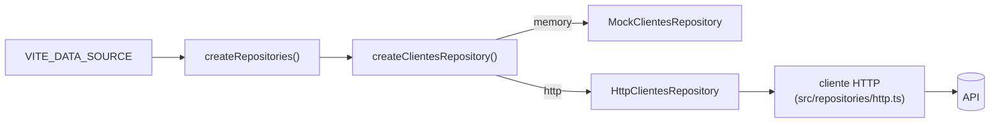

# Ligar uma API real

O `make:domain` gera um repositório em memória para você construir e testar as telas antes de a API existir. Este guia mostra como escrever a implementação HTTP do mesmo contrato, escolher a fonte de dados por ambiente e provar, com o teste de contrato, que as duas implementações se comportam igual.

O exemplo usa o domínio `clientes` e uma API REST com as rotas `GET /clientes`, `GET /clientes/:id`, `POST /clientes`, `PUT /clientes/:id` e `DELETE /clientes/:id`. Adapte os caminhos e o formato à sua API: o que não muda é o contrato.

## Como as peças se encaixam



As telas e as queries não mudam: elas usam a interface `IClientesRepository`, e o container entrega a implementação que a configuração escolher.

## 1. Declare a fonte de dados

```ts
// src/repositories/options.ts
export const DATA_SOURCES = ['memory', 'http'] as const
```

O tipo `DataSource` passa a ser `'memory' | 'http'`, e toda fábrica de repositório recebe a fonte escolhida em `options.dataSource`.

## 2. Escreva o cliente HTTP

Um cliente pequeno, comum a todos os domínios, concentra o endereço da API, os cabeçalhos e o tratamento da resposta:

```ts
// src/repositories/http.ts
export interface HttpRequest {
  method?: 'GET' | 'POST' | 'PUT' | 'PATCH' | 'DELETE'
  body?: unknown
}

/** Faz uma chamada à API e devolve o corpo da resposta (sem validar). */
export type Http = (path: string, request?: HttpRequest) => Promise<unknown>

export interface HttpOptions {
  baseUrl: string
  /** Cabeçalhos de toda chamada, como o token da sessão. */
  headers?: () => Record<string, string>
}

/** Resposta da API com status de erro. O repositório decide o que ela significa no domínio. */
export class HttpError extends Error {
  readonly status: number

  constructor(status: number, message: string) {
    super(message)
    this.name = 'HttpError'
    this.status = status
  }
}

export function createHttp({ baseUrl, headers }: HttpOptions): Http {
  return async (path, { method = 'GET', body } = {}) => {
    const response = await fetch(`${baseUrl}${path}`, {
      method,
      headers: { 'Content-Type': 'application/json', ...headers?.() },
      body: body === undefined ? undefined : JSON.stringify(body),
    })
    if (!response.ok) throw new HttpError(response.status, `${method} ${path}: HTTP ${response.status}`)
    return response.status === 204 ? undefined : response.json()
  }
}
```

E a instância do app, com o endereço que vem do ambiente:

```ts
// src/repositories/api.ts
import { createHttp } from './http'

export const api = createHttp({
  baseUrl: import.meta.env.VITE_API_URL ?? '/api',
  // headers: () => ({ Authorization: `Bearer ${getToken()}` }),
})
```

## 3. Implemente o contrato

A implementação HTTP mora ao lado do mock e implementa a mesma interface. Três cuidados:

- **Valide a resposta** com o schema do domínio. Se a API mudar o formato, o erro aparece na fronteira, e não numa tela.
- **Traduza os erros do domínio** para `UIError`. O contrato diz que um id inexistente rejeita com `UIError('CLIENTE_NOT_FOUND')`; o 404 da API vira esse erro. Os outros erros seguem como estão, e a interface mostra a mensagem genérica.
- **Codifique o que vai na URL** (`encodeURIComponent`).

```ts
// src/repositories/clientes/repository.http.ts
import { pageSchema, type Page } from '@matizze/prumo-core/data'
import { UIError } from '@matizze/prumo-core/errors'
import {
  clienteSchema,
  type ClienteInput,
  type ClienteListQuery,
  type ClienteSchema,
} from '@/schemas'
import { HttpError, type Http, type HttpRequest } from '../http'
import type { IClientesRepository } from './repository.contract'

const clientePageSchema = pageSchema(clienteSchema)

export class HttpClientesRepository implements IClientesRepository {
  private readonly http: Http

  constructor(http: Http) {
    this.http = http
  }

  async list(query: ClienteListQuery = {}): Promise<Page<ClienteSchema>> {
    const params = new URLSearchParams()
    if (query.search) params.set('search', query.search)
    if (query.sort) params.set('sort', `${query.sort.key}:${query.sort.direction}`)
    if (query.page) params.set('page', String(query.page))
    if (query.page_size) params.set('page_size', String(query.page_size))
    return clientePageSchema.parse(await this.http(`/clientes?${params}`))
  }

  async get(id: string): Promise<ClienteSchema> {
    return clienteSchema.parse(await this.existing(`/clientes/${encodeURIComponent(id)}`))
  }

  async create(input: ClienteInput): Promise<ClienteSchema> {
    return clienteSchema.parse(await this.http('/clientes', { method: 'POST', body: input }))
  }

  async update(id: string, input: ClienteInput): Promise<ClienteSchema> {
    const path = `/clientes/${encodeURIComponent(id)}`
    return clienteSchema.parse(await this.existing(path, { method: 'PUT', body: input }))
  }

  async remove(id: string): Promise<void> {
    await this.existing(`/clientes/${encodeURIComponent(id)}`, { method: 'DELETE' })
  }

  /** Uma chamada a um registro: o 404 da API é o `CLIENTE_NOT_FOUND` do contrato. */
  private async existing(path: string, request?: HttpRequest): Promise<unknown> {
    try {
      return await this.http(path, request)
    } catch (error) {
      if (error instanceof HttpError && error.status === 404) {
        throw new UIError('CLIENTE_NOT_FOUND', 'Registro não encontrado.')
      }
      throw error
    }
  }
}
```

> Se a API usa outro formato de lista (por exemplo, `{ data, meta: { total } }`), converta na própria implementação: o contrato devolve sempre `{ items, total }`.

## 4. Escolha a implementação na fábrica

A fábrica do domínio recebe a fonte de dados e cria a implementação certa:

```ts
// src/repositories/clientes/index.ts
import { api } from '../api'
import type { RepositoryOptions } from '../options'
import type { IClientesRepository } from './repository.contract'
import { HttpClientesRepository } from './repository.http'
import { MockClientesRepository } from './repository.mock'

// ... os exports do domínio continuam como estão

export function createClientesRepository({
  dataSource,
  latencyMs,
}: RepositoryOptions): IClientesRepository {
  if (dataSource === 'http') return new HttpClientesRepository(api)
  return new MockClientesRepository({ latencyMs })
}
```

Domínios que ainda não têm API continuam devolvendo o mock para qualquer fonte. Assim você liga a API domínio por domínio.

## 5. Escolha a fonte por ambiente

O `createRepositories` lê a fonte de uma variável de ambiente do Vite. O `resolveDataSource` do core usa `memory` quando a variável falta e **lança um erro** quando ela tem um valor desconhecido, para a inicialização falhar em vez de cair em silêncio em outra fonte:

```ts
// src/repositories/index.ts
export function createRepositories(options: Partial<RepositoryOptions> = {}): RepositoryContainer {
  const dataSource =
    options.dataSource ??
    resolveDataSource(import.meta.env.VITE_DATA_SOURCE, DATA_SOURCES, 'memory', 'VITE_DATA_SOURCE')
  return createRepositoryContainer(factories, { ...options, dataSource })
}
```

Declare as variáveis para o TypeScript:

```ts
// src/vite-env.d.ts
/// <reference types="vite/client" />

interface ImportMetaEnv {
  /** De onde os repositórios leem: memory (padrão) ou http. */
  readonly VITE_DATA_SOURCE?: string
  /** O endereço da API, para a fonte http. */
  readonly VITE_API_URL?: string
}
```

E configure cada ambiente num arquivo `.env` (o `.gitignore` do app ignora os `.env*`, menos o `.env.example`):

```bash
# .env.local
VITE_DATA_SOURCE=http
VITE_API_URL=http://localhost:3000
```

Os testes não mudam: o `renderWithProviders` do app cria o container com `dataSource: 'memory'` explícito, então continuam rodando contra o mock, sem rede.

> O `make:domain` continua funcionando depois dessas mudanças: ele só edita os imports, os `export *` e o mapa `factories` do `src/repositories/index.ts`.

## 6. Rode o contrato contra a API

O teste de contrato prova que as duas implementações se comportam igual. Acrescente a implementação HTTP no fim do arquivo, rodando só quando houver uma API de teste configurada:

```ts
// src/repositories/clientes/repository.contract.test.ts
import { createHttp } from '../http'
import { HttpClientesRepository } from './repository.http'

const contractApiUrl = process.env.CONTRACT_API_URL

if (contractApiUrl) {
  runContractSuite(clientesContract, {
    name: 'HttpClientesRepository',
    create: () => new HttpClientesRepository(createHttp({ baseUrl: contractApiUrl })),
    // dispose: () => resetarApiDeTeste(), // volta a API às fixtures depois de cada teste
  })
}
```

```bash
CONTRACT_API_URL=http://localhost:3000 pnpm test src/repositories/clientes
```

Um cuidado com os dados: parte dos casos depende das fixtures do mock ("lista as 3 fixtures", "busca por 'Exemplo 2'") e cria ou remove registros. Contra uma API, esses casos só valem se ela partir dos mesmos dados a cada teste. Use o `dispose` (ou o `create`) para restaurar a API de teste, por exemplo com uma rota de reset do ambiente de teste, ou separe os casos que dependem dos dados num contrato só do mock. Os casos que não dependem dos dados (ordenação, paginação, erro de id inexistente) valem para qualquer implementação. A referência do [`runContractSuite`](../reference/testing.md#teste-de-contrato) detalha o ciclo de vida de cada teste.

## Checklist

- [ ] `DATA_SOURCES` com a fonte nova
- [ ] Cliente HTTP comum e a instância do app
- [ ] `Http<Domínio>Repository` implementando o contrato, validando as respostas e traduzindo o 404
- [ ] A fábrica do domínio escolhendo pela fonte
- [ ] `createRepositories` lendo `VITE_DATA_SOURCE`, com as variáveis declaradas em `vite-env.d.ts`
- [ ] O contrato rodando contra a API de teste
- [ ] `pnpm verify` verde
