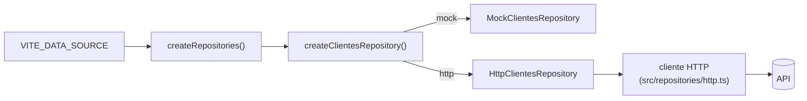

# Ligar uma API real

O `make:domain` gera um repositório em memória para você construir e testar as telas antes de a API existir. Este guia mostra como escrever a implementação HTTP do mesmo contrato, escolher a fonte de dados por ambiente e provar, com o teste de contrato, que as duas implementações se comportam igual.

O exemplo usa o domínio `clientes` e uma API REST com as rotas `GET /clientes`, `GET /clientes/:id`, `POST /clientes`, `PATCH /clientes/:id` e `DELETE /clientes/:id`. Adapte os caminhos e o formato à sua API: o que não muda é o contrato.

## Como as peças se encaixam



As telas e as queries não mudam: elas usam a interface `IClientesRepository`, e o container entrega a implementação que a configuração escolher.

## 1. Declare a fonte de dados

```ts
// src/repositories/options.ts
export const DATA_SOURCES = ['mock', 'http'] as const
```

O tipo `DataSource` passa a ser `'mock' | 'http'`, e toda fábrica de repositório recebe a fonte escolhida em `options.dataSource`.

## 2. Escreva o cliente HTTP

Um cliente pequeno, comum a todos os domínios, concentra o endereço da API, o token da sessão, o tratamento do 401 e a resposta. Ele recebe tudo de fora (o `fetch` e a sessão), então os testes o exercitam sem rede:

```ts
// src/repositories/http.ts
export interface HttpRequest {
  method?: 'GET' | 'POST' | 'PUT' | 'PATCH' | 'DELETE'
  body?: unknown
}

/** Faz uma chamada à API e devolve o corpo da resposta (sem validar). */
export type Http = (path: string, request?: HttpRequest) => Promise<unknown>

/** A sessão vista pelo cliente HTTP: o token da vez e a renovação depois de um 401. */
export interface HttpAuth {
  /** O token de acesso da sessão, ou `null` sem sessão. */
  getToken: () => string | null
  /**
   * Renova a sessão depois de um 401 do token `usedToken`. Devolve `true` quando há token novo
   * para repetir a chamada e `false` quando a renovação falhou (a sessão já foi encerrada).
   */
  refresh: (usedToken: string) => Promise<boolean>
}

export interface HttpOptions {
  baseUrl: string
  /** Cabeçalhos de toda chamada. */
  headers?: () => Record<string, string>
  /** O Bearer da sessão e o tratamento do 401: renova uma vez e repete a chamada. */
  auth?: HttpAuth
  /** Troca o `fetch` (testes, sem rede). */
  fetch?: typeof fetch
}

/** Resposta da API com status de erro. O repositório decide o que ela significa no domínio. */
export class HttpError extends Error {
  readonly status: number

  constructor(status: number, message: string) {
    super(message)
    this.name = 'HttpError'
    this.status = status
  }
}

export function createHttp({ baseUrl, headers, auth, fetch: fetchOverride }: HttpOptions): Http {
  const send = (path: string, { method = 'GET', body }: HttpRequest, token: string | null) =>
    (fetchOverride ?? fetch)(`${baseUrl}${path}`, {
      method,
      headers: {
        'Content-Type': 'application/json',
        ...headers?.(),
        ...(token ? { Authorization: `Bearer ${token}` } : {}),
      },
      body: body === undefined ? undefined : JSON.stringify(body),
    })

  return async (path, request = {}) => {
    const token = auth?.getToken() ?? null
    let response = await send(path, request, token)
    // 401 com sessão: renova o token (uma vez) e repete a chamada com o token novo
    if (response.status === 401 && auth && token !== null && (await auth.refresh(token))) {
      response = await send(path, request, auth.getToken())
    }
    if (!response.ok) {
      throw new HttpError(response.status, `${request.method ?? 'GET'} ${path}: HTTP ${response.status}`)
    }
    return response.status === 204 ? undefined : response.json()
  }
}
```

Três pontos do tratamento do 401:

- **Renova uma vez.** Se a chamada repetida também falha com 401, o erro sobe: não há laço de renovação.
- **Chamadas simultâneas esperam a mesma renovação.** Quem decide isso é a sessão (`refresh(usedToken)` guarda a promessa em andamento): se cinco chamadas levam 401 juntas, a API de renovação recebe um pedido só, e as cinco repetem com o token novo. Um refresh token costuma valer uma vez, então dois pedidos seriam um erro.
- **Renovação recusada encerra a sessão.** Quando o `refresh` devolve `false`, o cliente lança o `HttpError` 401, e a sessão já está anônima (o provedor limpa o cache e as rotas protegidas redirecionam para o login). Veja [Sessão e login](auth.md).

E a instância do app, com o endereço que vem do ambiente e o token que vem da sessão (que é lida fora do React, por isso é um módulo puro):

```ts
// src/repositories/api.ts
import { appSession } from '@/providers/session/app-session'
import { createHttp } from './http'

export const api = createHttp({
  baseUrl: import.meta.env.VITE_API_URL ?? '/api',
  auth: {
    getToken: () => appSession.getAccessToken(),
    refresh: (usedToken) => appSession.refresh(usedToken),
  },
})
```

Sem login, omita o `auth`: o cliente só envia o corpo e os `headers`.

### Testar o cliente HTTP sem rede

O `fetch` injetável é o que torna o cliente testável: o teste passa um `fetch` falso e confere o que foi chamado, sem servidor. Uma `Response` do Node basta como resposta:

```ts
// src/repositories/http.test.ts
import { expect, it, vi } from 'vitest'
import { createHttp, HttpError } from './http'

const json = (status: number, body: unknown) =>
  new Response(JSON.stringify(body), { status, headers: { 'Content-Type': 'application/json' } })

it('renova o token no 401 e repete a chamada com o token novo', async () => {
  let token = 'velho'
  const fetchFalso = vi.fn(async (_url: string | URL | Request, init?: RequestInit) => {
    const bearer = new Headers(init?.headers).get('Authorization')
    return bearer === 'Bearer novo' ? json(200, { ok: true }) : json(401, {})
  })
  const http = createHttp({
    baseUrl: 'https://api.exemplo.test',
    fetch: fetchFalso as typeof fetch,
    auth: {
      getToken: () => token,
      refresh: async () => {
        token = 'novo'
        return true
      },
    },
  })

  expect(await http('/clientes')).toEqual({ ok: true })
  expect(fetchFalso).toHaveBeenCalledTimes(2)
})

it('refresh recusado: a chamada falha com o 401', async () => {
  const http = createHttp({
    baseUrl: 'https://api.exemplo.test',
    fetch: (async () => json(401, {})) as typeof fetch,
    auth: { getToken: () => 'velho', refresh: async () => false },
  })

  await expect(http('/clientes')).rejects.toBeInstanceOf(HttpError)
})
```

Para o caso das chamadas simultâneas, teste a sessão (o `refresh` dela é quem junta os pedidos) com uma `AuthApi` falsa que conta as chamadas a `refresh`.

## 3. Implemente o contrato

A implementação HTTP mora ao lado do mock e implementa a mesma interface. Três cuidados:

- **Valide a resposta** com o schema do domínio. Se a API mudar o formato, o erro aparece na fronteira, e não numa tela.
- **Traduza os erros do domínio** para `UIError`. O contrato diz que um id inexistente rejeita com `UIError('CLIENTE_NOT_FOUND')`; o 404 da API vira esse erro. Um 403 pode virar `UIError('SEM_PERMISSAO')` e a rede fora do ar, `UIError('API_INDISPONIVEL')`, cada um com texto em `errors.<CÓDIGO>`. Os outros erros seguem como estão, e a interface mostra a mensagem genérica.
- **Codifique o que vai na URL** (`encodeURIComponent`).

```ts
// src/repositories/clientes/repository.http.ts
import { pageSchema, type Page } from '@matizze/prumo-core/data'
import { UIError } from '@matizze/prumo-core/errors'
import {
  clienteSchema,
  type ClienteInput,
  type ClienteListQuery,
  type ClienteSchema,
} from '@/schemas'
import { HttpError, type Http, type HttpRequest } from '../http'
import type { IClientesRepository } from './repository.contract'

const clientePageSchema = pageSchema(clienteSchema)

export class HttpClientesRepository implements IClientesRepository {
  private readonly http: Http

  constructor(http: Http) {
    this.http = http
  }

  async list(query: ClienteListQuery = {}): Promise<Page<ClienteSchema>> {
    const params = new URLSearchParams()
    if (query.search) params.set('search', query.search)
    if (query.sort) params.set('sort', `${query.sort.key}:${query.sort.direction}`)
    if (query.page) params.set('page', String(query.page))
    if (query.page_size) params.set('page_size', String(query.page_size))
    return clientePageSchema.parse(await this.http(`/clientes?${params}`))
  }

  async get(id: string): Promise<ClienteSchema> {
    return clienteSchema.parse(await this.existing(`/clientes/${encodeURIComponent(id)}`))
  }

  async create(input: ClienteInput): Promise<ClienteSchema> {
    return clienteSchema.parse(await this.http('/clientes', { method: 'POST', body: input }))
  }

  async update(id: string, input: Partial<ClienteInput>): Promise<ClienteSchema> {
    const path = `/clientes/${encodeURIComponent(id)}`
    return clienteSchema.parse(await this.existing(path, { method: 'PATCH', body: input }))
  }

  async remove(id: string): Promise<void> {
    await this.existing(`/clientes/${encodeURIComponent(id)}`, { method: 'DELETE' })
  }

  /** Uma chamada a um registro: o 404 da API é o `CLIENTE_NOT_FOUND` do contrato. */
  private async existing(path: string, request?: HttpRequest): Promise<unknown> {
    try {
      return await this.http(path, request)
    } catch (error) {
      if (error instanceof HttpError && error.status === 404) {
        throw new UIError('CLIENTE_NOT_FOUND', 'Registro não encontrado.')
      }
      throw error
    }
  }
}
```

> Se a API usa outro formato de lista (por exemplo, `{ data, meta: { total } }`), converta na própria implementação: o contrato devolve sempre `{ items, total }`.

## 4. Escolha a implementação na fábrica

A fábrica do domínio recebe a fonte de dados e cria a implementação certa:

```ts
// src/repositories/clientes/index.ts
import { api } from '../api'
import type { RepositoryOptions } from '../options'
import type { IClientesRepository } from './repository.contract'
import { HttpClientesRepository } from './repository.http'
import { MockClientesRepository } from './repository.mock'

// ... os exports do domínio continuam como estão

export function createClientesRepository({
  dataSource,
  latencyMs,
}: RepositoryOptions): IClientesRepository {
  if (dataSource === 'http') return new HttpClientesRepository(api)
  return new MockClientesRepository({ latencyMs })
}
```

Domínios que ainda não têm API continuam devolvendo o mock para qualquer fonte. Assim você liga a API domínio por domínio.

## 5. Escolha a fonte por ambiente

O `createRepositories` lê a fonte de uma variável de ambiente do Vite. O `resolveDataSource` do core usa `mock` quando a variável falta e **lança um erro** quando ela tem um valor desconhecido, para a inicialização falhar em vez de cair em silêncio em outra fonte:

```ts
// src/repositories/index.ts
export function createRepositories(options: Partial<RepositoryOptions> = {}): RepositoryContainer {
  const dataSource =
    options.dataSource ??
    resolveDataSource(import.meta.env.VITE_DATA_SOURCE, DATA_SOURCES, 'mock', 'VITE_DATA_SOURCE')
  return createRepositoryContainer(factories, { ...options, dataSource })
}
```

Declare as variáveis para o TypeScript:

```ts
// src/vite-env.d.ts
/// <reference types="vite/client" />

interface ImportMetaEnv {
  /** De onde os repositórios leem: mock (padrão) ou http. */
  readonly VITE_DATA_SOURCE?: string
  /** O endereço da API, para a fonte http. */
  readonly VITE_API_URL?: string
}
```

E configure cada ambiente num arquivo `.env` (o `.gitignore` do app ignora os `.env*`, menos o `.env.example`):

```bash
# .env.local
VITE_DATA_SOURCE=http
VITE_API_URL=http://localhost:3000
```

Os testes não mudam: o `renderWithProviders` do app cria o container com `dataSource: 'mock'` explícito, então continuam rodando contra o mock, sem rede.

> O `make:domain` continua funcionando depois dessas mudanças: ele só edita os imports, os `export *` e o mapa `factories` do `src/repositories/index.ts`.

## 6. Rode o contrato contra a API

O teste de contrato prova que as duas implementações se comportam igual. Acrescente a implementação HTTP no fim do arquivo, rodando só quando houver uma API de teste configurada:

```ts
// src/repositories/clientes/repository.contract.test.ts
import { createHttp } from '../http'
import { HttpClientesRepository } from './repository.http'

const contractApiUrl = process.env.CONTRACT_API_URL

if (contractApiUrl) {
  runContractSuite(clientesContract, {
    name: 'HttpClientesRepository',
    create: () => new HttpClientesRepository(createHttp({ baseUrl: contractApiUrl })),
    // dispose: () => resetarApiDeTeste(), // volta a API às fixtures depois de cada teste
  })
}
```

```bash
CONTRACT_API_URL=http://localhost:3000 pnpm test src/repositories/clientes
```

Um cuidado com os dados: parte dos casos depende das fixtures do mock ("lista as 3 fixtures", "busca por 'Exemplo 2'") e cria ou remove registros. Contra uma API, esses casos só valem se ela partir dos mesmos dados a cada teste. Use o `dispose` (ou o `create`) para restaurar a API de teste, por exemplo com uma rota de reset do ambiente de teste, ou separe os casos que dependem dos dados num contrato só do mock. Os casos que não dependem dos dados (ordenação, paginação, erro de id inexistente) valem para qualquer implementação. A referência do [`runContractSuite`](../reference/testing.md#teste-de-contrato) detalha o ciclo de vida de cada teste.

### Quando a API de teste não persiste escritas

Muitas APIs públicas de demonstração (a DummyJSON, por exemplo) só **simulam** as escritas: o `POST` responde como se tivesse criado, mas a leitura seguinte não vê o registro. Os casos do contrato que criam, editam ou removem e depois leem (`create` e depois `get`, `remove` e depois `list`) falham contra uma API assim, sem que o repositório tenha erro.

O caminho é rodar o contrato contra uma **API falsa em memória**, ligada pelo `fetch` injetável do cliente (passo 2). Ela implementa só as rotas do domínio e **grava de verdade**, então o contrato inteiro roda, sem rede, junto com os testes do app, e o repositório HTTP (a montagem da URL, a validação das respostas, o 404 que vira `CLIENTE_NOT_FOUND`) é exercitado de ponta a ponta:

```ts
// src/test/fake-api.ts
import { MOCK_CLIENTES } from '@/repositories'
import type { ClienteSchema } from '@/schemas'

const json = (status: number, body?: unknown) =>
  new Response(body === undefined ? null : JSON.stringify(body), {
    status,
    headers: { 'Content-Type': 'application/json' },
  })

/** Uma API de clientes na memória, com as mesmas rotas da real e escrita que persiste. */
export function createFakeApi(initial: ClienteSchema[] = MOCK_CLIENTES) {
  const items = initial.map((item) => ({ ...item }))
  let nextId = items.length + 1

  const fetchFalso = (async (input: string | URL | Request, init?: RequestInit) => {
    const url = new URL(String(input))
    const method = init?.method ?? 'GET'
    const body = init?.body ? JSON.parse(String(init.body)) : undefined
    const id = /^\/clientes\/([^/]+)$/.exec(url.pathname)?.[1]

    if (url.pathname === '/clientes' && method === 'GET') {
      const search = (url.searchParams.get('search') ?? '').toLowerCase()
      const found = items.filter((item) => item.name.toLowerCase().includes(search))
      return json(200, { items: found, total: found.length })
    }
    if (url.pathname === '/clientes' && method === 'POST') {
      const created = { id: `cliente-${nextId++}`, createdAt: new Date().toISOString(), ...body }
      items.push(created)
      return json(201, created)
    }
    const index = items.findIndex((item) => item.id === id)
    if (id === undefined || index === -1) return json(404)
    if (method === 'GET') return json(200, items[index])
    if (method === 'PATCH') return json(200, Object.assign(items[index]!, body))
    items.splice(index, 1) // DELETE
    return json(204)
  }) as typeof fetch

  return { fetch: fetchFalso }
}
```

```ts
// src/repositories/clientes/repository.contract.test.ts (no mesmo arquivo do contrato)
import { createFakeApi } from '@/test/fake-api'
import { createHttp } from '../http'
import { HttpClientesRepository } from './repository.http'

runContractSuite(clientesContract, {
  name: 'HttpClientesRepository (API falsa)',
  create: () => new HttpClientesRepository(createHttp({ baseUrl: 'https://api.exemplo.test', fetch: createFakeApi().fetch })),
})
```

Cada `create()` cria uma API falsa nova, com as fixtures, e por isso os testes não compartilham estado. A diferença para a API real fica registrada no próprio arquivo da API falsa (por exemplo, a busca que olha só o nome): se a real se comportar diferente nesse ponto, o contrato contra `CONTRACT_API_URL` (acima) mostra, nos casos que não dependem de escrita. Mantenha os dois: o falso prova o repositório, e o real prova que a API é o que o falso diz que é.

## Checklist

- [ ] `DATA_SOURCES` com a fonte nova
- [ ] Cliente HTTP comum (com o token da sessão, a renovação no 401 e o `fetch` injetável) e a instância do app
- [ ] `Http<Domínio>Repository` implementando o contrato, validando as respostas e traduzindo o 404
- [ ] A fábrica do domínio escolhendo pela fonte
- [ ] `createRepositories` lendo `VITE_DATA_SOURCE`, com as variáveis declaradas em `vite-env.d.ts`
- [ ] O contrato rodando contra a API de teste, ou contra uma API falsa em memória quando ela não persiste escritas
- [ ] `pnpm verify` verde
