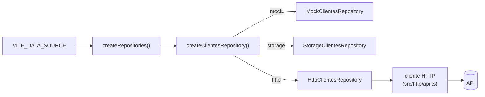

# Ligar uma API real

O `prumo make:repository` gera um repositório em memória (`mock`) para você construir e testar as telas antes de a API existir. Este guia mostra o caminho para a API de verdade: um comando gera a implementação HTTP do mesmo contrato, e o app escolhe a fonte por ambiente. O teste de contrato prova que o mock e a API se comportam igual.

O exemplo usa o domínio `clientes` e uma API REST com as rotas `GET /clientes`, `GET /clientes/:id`, `POST /clientes`, `PATCH /clientes/:id` e `DELETE /clientes/:id`.

## Como as peças se encaixam



As telas e as queries não mudam: elas usam a interface `IClientesRepository`, e o container entrega a implementação que a configuração escolher. Um domínio sem a fonte pedida devolve o mock, então você liga a API domínio por domínio.

## 1. Gere a fonte http

```bash
pnpm exec prumo make:repository clientes --data-source http
```

Se o repositório `clientes` ainda não existe, o comando cria o repositório inteiro (contrato, mock, dados de exemplo, teste de contrato e fábrica) e acrescenta a fonte; se já existe, acrescenta só a fonte. Repetir a mesma fonte sai com 2. O que o comando faz:

- cria `src/repositories/clientes/repository.http.ts`, a classe `HttpClientesRepository`;
- importa o `api` de `@/http/api` na fábrica e o `HttpError` e o tipo `Http` de `@matizze/prumo-core/http`; o app novo já traz `src/http/api.ts` (a instância, com o endereço e o lugar do token), e o comando o cria, com o `src/vite-env.d.ts`, só num app de antes dele;
- acrescenta `'http'` ao `DATA_SOURCES` de `src/repositories/options.ts`, se ainda não está lá;
- muda a fábrica `src/repositories/clientes/index.ts`: o import, o export da classe e uma linha por fonte, antes do `return` que devolve o mock:

```ts
export function createClientesRepository({ dataSource, latencyMs }: RepositoryOptions): IClientesRepository {
  if (dataSource === 'http') return new HttpClientesRepository(api)
  return new MockClientesRepository({ latencyMs })
}
```

- acrescenta ao `repository.contract.test.ts` uma chamada do `runContractSuite` para a fonte (veja o [passo 5](#5-rode-o-contrato-contra-uma-api-de-teste)).

`--dry-run` lista tudo isso sem escrever.

## 2. O que o backend precisa responder

O `HttpClientesRepository` **não traduz formato**: o backend responde no formato do app, e o repositório só valida cada resposta com o schema da entidade (`pageSchema(clienteSchema)` na lista). Se a API mudar o formato, o erro aparece na fronteira, e não numa tela.

| Chamada                                  | Corpo enviado           | Resposta esperada                                                  |
| ---------------------------------------- | ----------------------- | ------------------------------------------------------------------ |
| `GET /clientes`                          | nenhum                  | `{ "items": [...], "total": 42 }`                                  |
| `GET /clientes/:id`                      | nenhum                  | o cliente                                                          |
| `POST /clientes`                         | os campos do input      | o cliente criado, com `id` e `createdAt`                           |
| `PATCH /clientes/:id`                    | só os campos que mudam  | o cliente inteiro, já atualizado                                   |
| `DELETE /clientes/:id`                   | nenhum                  | `204` (ou qualquer `2xx`: um corpo vazio ou que não é JSON é ignorado) |
| `GET`, `PATCH` ou `DELETE` de id que não existe | nenhum           | `404`, que vira `UIError('CLIENTE_NOT_FOUND')`                     |

Os parâmetros da lista, todos opcionais:

- `search`: o texto da busca;
- `sort`: `<campo>:<asc|desc>`, por exemplo `sort=nome:desc`;
- `page`: a página, a partir de 1;
- `page_size`: o tamanho da página.

O `total` é o de antes da página. Os campos dos registros têm os nomes do schema (camelCase), e o `id` é um texto. Os ids vão codificados na URL (`encodeURIComponent`).

O `update` usa `PATCH`, e não `PUT`, porque o contrato aceita `Partial<Input>`: o repositório envia só o que mudou. Se a sua API só tem `PUT`, troque o método no `repository.http.ts`.

## 3. O cliente HTTP e o token

O cliente HTTP é o `createHttp` do `@matizze/prumo-core/http`, comum a todos os domínios e aos use cases: concentra o endereço da API, o token da sessão, o tratamento do 401 e a resposta. Ele recebe tudo de fora (o `fetch` e a sessão), então os testes o exercitam sem rede (o core já os tem). Um status de erro vira `HttpError` (com o `status` e o `body` da resposta), e o repositório decide o que ele significa no domínio.

A instância do app é o `src/http/api.ts`:

```ts
import { createHttp } from '@matizze/prumo-core/http'

export const api = createHttp({
  baseUrl: import.meta.env.VITE_API_URL || '/api',
  // O token da sessão: quando o app tiver login, descomente e ligue à sessão do app.
  // auth: {
  //   getToken: () => appSession.getAccessToken(),
  //   refresh: (usedToken) => appSession.refresh(usedToken),
  // },
})
```

O endereço vem da `VITE_API_URL`; vazia, vale como ausente (`/api`), e a barra no fim é aparada. Sem login, deixe como está: o cliente só envia o corpo. Com login, o token vem da sessão (que é lida fora do React, por isso é um módulo puro): descomente o `auth` e importe o `appSession` do app. Veja [Sessão e login](auth.md).

Três pontos do tratamento do 401:

- **Renova uma vez.** Se a chamada repetida também falha com 401, o erro sobe: não há laço de renovação.
- **Chamadas simultâneas esperam a mesma renovação.** Quem decide isso é a sessão (`refresh(usedToken)` guarda a promessa em andamento): se cinco chamadas levam 401 juntas, a API de renovação recebe um pedido só, e as cinco repetem com o token novo. Um refresh token costuma valer uma vez, então dois pedidos seriam um erro.
- **Renovação recusada encerra a sessão.** Quando o `refresh` devolve `false`, o cliente lança o `HttpError` 401, e a sessão já está anônima (o provedor limpa o cache e as rotas protegidas redirecionam para o login).

### Testar o cliente HTTP sem rede

O `fetch` injetável é o que torna o cliente testável: o teste passa um `fetch` falso e confere o que foi chamado, sem servidor. Uma `Response` do Node basta como resposta:

```ts
// src/http/api.test.ts
import { createHttp, HttpError } from '@matizze/prumo-core/http'
import { expect, it, vi } from 'vitest'

const json = (status: number, body: unknown) =>
  new Response(JSON.stringify(body), { status, headers: { 'Content-Type': 'application/json' } })

it('renova o token no 401 e repete a chamada com o token novo', async () => {
  let token = 'velho'
  const fetchFalso = vi.fn(async (_url: string | URL | Request, init?: RequestInit) => {
    const bearer = new Headers(init?.headers).get('Authorization')
    return bearer === 'Bearer novo' ? json(200, { ok: true }) : json(401, {})
  })
  const http = createHttp({
    baseUrl: 'https://api.exemplo.test',
    fetch: fetchFalso as typeof fetch,
    auth: {
      getToken: () => token,
      refresh: async () => {
        token = 'novo'
        return true
      },
    },
  })

  expect(await http('/clientes')).toEqual({ ok: true })
  expect(fetchFalso).toHaveBeenCalledTimes(2)
})

it('refresh recusado: a chamada falha com o 401', async () => {
  const http = createHttp({
    baseUrl: 'https://api.exemplo.test',
    fetch: (async () => json(401, {})) as typeof fetch,
    auth: { getToken: () => 'velho', refresh: async () => false },
  })

  await expect(http('/clientes')).rejects.toBeInstanceOf(HttpError)
})
```

Para o caso das chamadas simultâneas, teste a sessão (o `refresh` dela é quem junta os pedidos) com uma `AuthApi` falsa que conta as chamadas a `refresh`.

> **Use cases e a mesma variável.** A `VITE_DATA_SOURCE` também vale para os use cases (`src/use-cases`): `http` liga a API, e qualquer outro valor, inclusive `storage`, usa o mock deles. Enquanto os repositórios e os use cases convivem, cada camada lê a variável do seu jeito.

> **App de antes dos use cases.** Se o app tem `src/repositories/api.ts` e `src/repositories/http.ts`, o `make:repository --data-source http` cria o `src/http/api.ts` ao lado e avisa. Para migrar: troque nos repositórios o import `../api` por `@/http/api`, o `HttpError` e o tipo `Http` por `@matizze/prumo-core/http`, e apague os dois arquivos antigos (e o `http.test.ts`, se houver: o core já testa o cliente).

## 4. Escolha a fonte por ambiente

O `createRepositories` do app (`src/repositories/index.ts`) já nasce lendo (num app criado antes, o primeiro `--data-source` troca o `resolveDataSource(undefined, ...)` pela versão que lê a variável, ou avisa como fazer, se o container foi mudado) a fonte da variável de ambiente `VITE_DATA_SOURCE`. O `resolveDataSource` do core usa `mock` quando a variável falta e **lança um erro** quando ela tem um valor desconhecido, para a inicialização falhar em vez de cair em silêncio em outra fonte:

```ts
const dataSource =
  options.dataSource ??
  resolveDataSource(import.meta.env.VITE_DATA_SOURCE, DATA_SOURCES, 'mock', 'VITE_DATA_SOURCE')
```

O `src/vite-env.d.ts`, que o `prumo new` cria, declara `VITE_DATA_SOURCE` e `VITE_API_URL` (as duas opcionais) para o TypeScript. Configure cada ambiente num arquivo `.env` (o `.gitignore` do app ignora os `.env*`, menos o `.env.example`):

```bash
# .env.local
VITE_DATA_SOURCE=http
VITE_API_URL=http://localhost:3000
```

A fonte vale para todos os domínios do app, e o domínio que não tem a fonte devolve o mock. Reinicie o `pnpm dev` ao mudar o `.env`.

Os testes não mudam: o `renderWithProviders` do app cria o container com `dataSource: 'mock'` explícito, então continuam rodando contra o mock, sem rede.

## 5. Rode o contrato contra uma API de teste

O comando acrescentou ao `repository.contract.test.ts` a chamada do contrato para a fonte http:

```ts
const apiTestUrl = process.env.API_TEST_URL

describe.skipIf(!apiTestUrl)('HttpClientesRepository contra a API de teste (pulado: defina API_TEST_URL)', () => {
  runContractSuite(clientesContract, {
    name: 'HttpClientesRepository',
    create: () => new HttpClientesRepository(createHttp({ baseUrl: apiTestUrl ?? '' })),
    // dispose: () => resetApiDeTeste(), // volta a API às fixtures depois de cada teste
  })
})
```

Sem `API_TEST_URL`, os casos ficam **pulados**, e o título do teste diz o motivo; o `pnpm verify` continua verde sem API. Para rodar contra uma API de teste:

```bash
API_TEST_URL=http://localhost:3000 pnpm test src/repositories/clientes
```

Um cuidado com os dados: parte dos casos depende das fixtures do mock ("lista as 3 fixtures", a busca pelo primeiro registro) e cria ou remove registros. Contra uma API, esses casos só valem se ela partir dos mesmos dados a cada teste. Use o `dispose` (ou o `create`) para restaurar a API de teste, por exemplo com uma rota de reset do ambiente de teste. Os casos que não dependem dos dados (ordenação, paginação, erro de id inexistente) valem para qualquer implementação. A referência do [`runContractSuite`](../reference/testing.md#teste-de-contrato) detalha o ciclo de vida de cada teste.

### Quando a API de teste não persiste escritas

Muitas APIs públicas de demonstração (a DummyJSON, por exemplo) só **simulam** as escritas: o `POST` responde como se tivesse criado, mas a leitura seguinte não vê o registro. Os casos do contrato que criam, editam ou removem e depois leem falham contra uma API assim, sem que o repositório tenha erro.

O caminho é rodar o contrato contra uma **API falsa em memória**, no lugar do `fetch` global. Ela implementa só as rotas do domínio e **grava de verdade**, então o contrato inteiro roda, sem rede, junto com os testes do app, e o repositório HTTP (a montagem da URL, a validação das respostas, o 404 que vira `CLIENTE_NOT_FOUND`) é exercitado de ponta a ponta. Instale-a num arquivo de setup do Vitest e aponte o `API_TEST_URL` para o endereço de mentira:

```ts
// src/test/fake-api.ts: coloque-o em setupFiles, no vite.config.ts
import { matchesSearch, paginate, sortBy } from '@matizze/prumo-core/mock'
import { beforeEach, vi } from 'vitest'
import { MOCK_CLIENTES } from '@/repositories/clientes/fixtures'

const json = (status: number, body?: unknown) =>
  new Response(body === undefined ? null : JSON.stringify(body), {
    status,
    headers: { 'Content-Type': 'application/json' },
  })

let items = MOCK_CLIENTES.map((item) => ({ ...item }))
let sequence = items.length
// Cada teste parte das fixtures: os casos do contrato dependem delas
beforeEach(() => {
  items = MOCK_CLIENTES.map((item) => ({ ...item }))
  sequence = items.length
})

vi.stubGlobal('fetch', async (input: string | URL | Request, init?: RequestInit) => {
  const url = new URL(String(input))
  const method = init?.method ?? 'GET'
  const body = init?.body ? JSON.parse(String(init.body)) : {}

  if (url.pathname === '/clientes' && method === 'GET') {
    const found = items.filter((item) =>
      matchesSearch([item.nome], url.searchParams.get('search') ?? undefined),
    )
    const [key = '', direction] = (url.searchParams.get('sort') ?? '').split(':')
    const sorted = key
      ? sortBy(found, { key, direction: direction === 'desc' ? 'desc' : 'asc' }, {
          [key]: (item: (typeof items)[number]) => String((item as Record<string, unknown>)[key]),
        })
      : found
    const page = Number(url.searchParams.get('page') ?? 1)
    const size = Number(url.searchParams.get('page_size') ?? 0)
    return json(200, paginate(sorted, page, size || undefined))
  }
  if (url.pathname === '/clientes' && method === 'POST') {
    sequence += 1
    const created = { id: `cliente-${sequence}`, ...body, createdAt: new Date().toISOString() }
    items.push(created)
    return json(201, created)
  }
  const id = /^\/clientes\/([^/]+)$/.exec(url.pathname)?.[1]
  const at = items.findIndex((item) => item.id === id)
  const found = items[at]
  if (!found) return json(404)
  if (method === 'PATCH') return json(200, (items[at] = { ...found, ...body }))
  if (method === 'DELETE') {
    items.splice(at, 1)
    return json(204)
  }
  return json(200, found)
})
```

```bash
API_TEST_URL=http://api.exemplo.test pnpm test src/repositories/clientes
```

A diferença para a API real fica registrada no próprio arquivo da API falsa (por exemplo, a busca que olha só o campo `nome`): se a real se comportar diferente nesse ponto, o contrato contra a API de teste de verdade mostra, nos casos que não dependem de escrita. Mantenha os dois: o falso prova o repositório, e o real prova que a API é o que o falso diz que é.

## 6. Quando a API não segue o formato

O `repository.http.ts` é seu depois de gerado: edite-o onde a API difere.

- **Outro formato de lista.** Se a API responde `{ data, meta: { total } }`, converta no `list`: o contrato devolve sempre `{ items, total }`.
- **Erros do domínio.** O 404 já vira `UIError('CLIENTE_NOT_FOUND')`. Um 403 pode virar `UIError('SEM_PERMISSAO')` e a rede fora do ar, `UIError('API_INDISPONIVEL')`, cada um com texto em `errors.<CÓDIGO>`. Os outros erros seguem como estão, e a interface mostra a mensagem genérica.
- **Outro método ou outro caminho.** O caminho de cada rota está no próprio arquivo (`/clientes`, `/clientes/:id`).

## Outra fonte: storage

```bash
pnpm exec prumo make:repository clientes --data-source storage
```

Cria `repository.storage.ts`, a classe `StorageClientesRepository`: o mock gravando no `localStorage`, com a chave `<nome do app>:clientes` (o nome é o `name` do `package.json`). Começa com as fixtures quando a chave não existe, usa a mesma busca, ordem e paginação do mock e respeita o contrato inteiro. Serve para um protótipo que guarda os dados entre uma visita e outra, sem backend. Na leitura, cada registro é conferido com o schema: o que não é aceito (corrompido, ou de um schema antigo) é descartado, com um `console.warn` com a chave e o id, e os outros ficam; se o JSON inteiro não se lê, o repositório recomeça das fixtures, também com aviso. Na escrita, o registro resultante é conferido antes de gravar, e o inválido rejeita com `UIError('<ENTIDADE>_INVALID')` (o comando acrescenta o texto ao `errors.json`) sem gravar nada. No `update`, um campo `undefined` não muda o campo (no storage e no mock). Para usar, `VITE_DATA_SOURCE=storage`. O contrato roda contra ele no `pnpm test` (o jsdom do app tem `localStorage`), limpando a chave antes de cada repositório novo.
