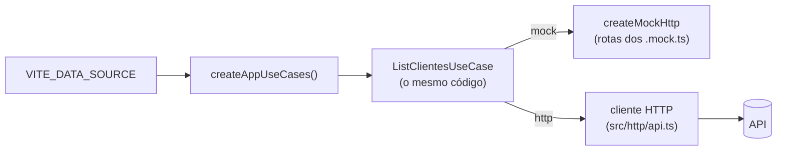

# Ligar uma API real

Os use cases do Prumo nascem rodando sobre um `http` de mentira (o `mock`), para você construir e testar as telas antes de a API existir. Este guia mostra o caminho para a API de verdade: o **mesmo** código do use case roda contra a API, e o app escolhe o transporte por ambiente. O teste de cada use case roda contra o mock e, com `API_TEST_URL`, contra a API de teste, o que prova que os dois se comportam igual.

O exemplo usa o domínio `clientes` e uma API REST com as rotas que o `make:usecase clientes --crud` gera: `GET /clientes`, `GET /clientes/:id`, `POST /clientes`, `PATCH /clientes/:id` e `DELETE /clientes/:id`.

## Como as peças se encaixam



As telas não mudam: elas usam `useUseCases()`, e o registro entrega os use cases sobre o transporte que a configuração escolher. Só a rede é trocada: a validação do Input e do Output com zod, o endereço e a tradução do erro são os mesmos no mock, nos testes e em produção.

## 1. O que o backend precisa responder

O use case **não traduz formato**: o backend responde no formato do app, e o use case só valida cada resposta com o Output (o schema da entidade, e `pageSchema(clienteSchema)` na lista). Se a API mudar o formato, o erro aparece na fronteira, e não numa tela. O endereço de cada use case está no `ENDPOINT` do `.types.ts`, e é editável.

| Chamada                                  | Corpo enviado           | Resposta esperada                                                  |
| ---------------------------------------- | ----------------------- | ------------------------------------------------------------------ |
| `GET /clientes`                          | nenhum (o Input vai como query string) | `{ "items": [...], "total": 42 }`                    |
| `GET /clientes/:id`                      | nenhum                  | o cliente                                                          |
| `POST /clientes`                         | os campos do Input      | o cliente criado, com `id` e `createdAt`                           |
| `PATCH /clientes/:id`                    | só os campos que mudam  | o cliente inteiro, já atualizado                                   |
| `DELETE /clientes/:id`                   | nenhum                  | `204` (ou qualquer `2xx`: um corpo vazio ou que não é JSON é ignorado) |
| `GET`, `PATCH` ou `DELETE` de id que não existe | nenhum           | `404`, que vira `UIError('CLIENTE_NOT_FOUND')`                     |

Os parâmetros da lista, todos opcionais:

- `search`: o texto da busca;
- `sort`: `<campo>:<asc|desc>`, por exemplo `sort=nome:desc`;
- `page`: a página, a partir de 1;
- `page_size`: o tamanho da página.

O `total` é o de antes da página. Os campos dos registros têm os nomes do schema (camelCase), e o `id` é um texto. O `:id` vai codificado na URL (`encodeURIComponent`). O `updateCliente` usa `PATCH`, e não `PUT`, porque envia só o que mudou: se a sua API só tem `PUT`, troque o método no `ENDPOINT` do `update-cliente.types.ts`.

## 2. O cliente HTTP e o token

O cliente HTTP é o `createHttp` do `@matizze/prumo-core/http`, comum a todos os use cases: concentra o endereço da API, o token da sessão, o tratamento do 401 e a resposta. Ele recebe tudo de fora (o `fetch` e a sessão), então os testes o exercitam sem rede (o core já os tem). Um status de erro vira `HttpError` (com o `status` e o `body` da resposta), e o use case decide o que ele significa no domínio.

A instância do app é o `src/http/api.ts`:

```ts
import { createHttp } from '@matizze/prumo-core/http'

export const api = createHttp({
  baseUrl: import.meta.env.VITE_API_URL || '/api',
  // O token da sessão: quando o app tiver login, descomente e ligue à sessão do app.
  // auth: {
  //   getToken: () => appSession.getAccessToken(),
  //   refresh: (usedToken) => appSession.refresh(usedToken),
  // },
})
```

O endereço vem da `VITE_API_URL`; vazia, vale como ausente (`/api`), e a barra no fim é aparada. Sem login, deixe como está: o cliente só envia o corpo. Com login, o token vem da sessão (que é lida fora do React, por isso é um módulo puro): descomente o `auth` e importe o `appSession` do app. Veja [Sessão e login](auth.md).

Três pontos do tratamento do 401:

- **Renova uma vez.** Se a chamada repetida também falha com 401, o erro sobe: não há laço de renovação.
- **Chamadas simultâneas esperam a mesma renovação.** Quem decide isso é a sessão (`refresh(usedToken)` guarda a promessa em andamento): se cinco chamadas levam 401 juntas, a API de renovação recebe um pedido só, e as cinco repetem com o token novo. Um refresh token costuma valer uma vez, então dois pedidos seriam um erro.
- **Renovação recusada encerra a sessão.** Quando o `refresh` devolve `false`, o cliente lança o `HttpError` 401, e a sessão já está anônima (o provedor limpa o cache e as rotas protegidas redirecionam para o login).

### Testar o cliente HTTP sem rede

O `fetch` injetável é o que torna o cliente testável: o teste passa um `fetch` falso e confere o que foi chamado, sem servidor. Uma `Response` do Node basta como resposta:

```ts
// src/http/api.test.ts
import { createHttp, HttpError } from '@matizze/prumo-core/http'
import { expect, it, vi } from 'vitest'

const json = (status: number, body: unknown) =>
  new Response(JSON.stringify(body), { status, headers: { 'Content-Type': 'application/json' } })

it('renova o token no 401 e repete a chamada com o token novo', async () => {
  let token = 'velho'
  const fetchFalso = vi.fn(async (_url: string | URL | Request, init?: RequestInit) => {
    const bearer = new Headers(init?.headers).get('Authorization')
    return bearer === 'Bearer novo' ? json(200, { ok: true }) : json(401, {})
  })
  const http = createHttp({
    baseUrl: 'https://api.exemplo.test',
    fetch: fetchFalso as typeof fetch,
    auth: {
      getToken: () => token,
      refresh: async () => {
        token = 'novo'
        return true
      },
    },
  })

  expect(await http('/clientes')).toEqual({ ok: true })
  expect(fetchFalso).toHaveBeenCalledTimes(2)
})

it('refresh recusado: a chamada falha com o 401', async () => {
  const http = createHttp({
    baseUrl: 'https://api.exemplo.test',
    fetch: (async () => json(401, {})) as typeof fetch,
    auth: { getToken: () => 'velho', refresh: async () => false },
  })

  await expect(http('/clientes')).rejects.toBeInstanceOf(HttpError)
})
```

Para o caso das chamadas simultâneas, teste a sessão (o `refresh` dela é quem junta os pedidos) com uma `AuthApi` falsa que conta as chamadas a `refresh`.

## 3. Escolha o transporte por ambiente

O `createAppUseCases` do app (`src/use-cases/index.ts`) lê a fonte da variável de ambiente `VITE_DATA_SOURCE`. O `resolveDataSource` do core usa `mock` quando a variável falta e **lança um erro** quando ela tem um valor desconhecido (`Invalid VITE_DATA_SOURCE "x". Expected one of: mock, http.`), para a inicialização falhar em vez de cair em silêncio em outra fonte:

```ts
const dataSource =
  options.dataSource ??
  resolveDataSource(import.meta.env.VITE_DATA_SOURCE, DATA_SOURCES, 'mock', 'VITE_DATA_SOURCE')
```

O `src/vite-env.d.ts`, que o `prumo new` cria, declara `VITE_DATA_SOURCE` e `VITE_API_URL` (as duas opcionais) para o TypeScript. Configure cada ambiente num arquivo `.env` (o `.gitignore` do app ignora os `.env*`, menos o `.env.example`):

```bash
# .env.local
VITE_DATA_SOURCE=http
VITE_API_URL=http://localhost:3000
```

A fonte vale para todos os use cases do app. Reinicie o `pnpm dev` ao mudar o `.env`. Os testes não mudam: o `renderWithProviders` do app cria o container com `dataSource: 'mock'` explícito, então continuam rodando contra o mock, sem rede.

## 4. Rode o contrato contra uma API de teste

Cada use case traz, no `.usecase.test.ts`, o mesmo contrato rodando contra o `http` de mentira e, com `API_TEST_URL`, contra a API:

```ts
const apiTestUrl = process.env.API_TEST_URL

describe.skipIf(!apiTestUrl)('ListClientesUseCase contra a API de teste (pulado: defina API_TEST_URL)', () => {
  runContractSuite(listClientesContract, {
    name: 'API',
    create: () => new ListClientesUseCase(createHttp({ baseUrl: apiTestUrl ?? '' })),
  })
})
```

Sem `API_TEST_URL`, os casos ficam **pulados**, e o título do teste diz o motivo; o `pnpm verify` continua verde sem API. Para rodar contra uma API de teste:

```bash
API_TEST_URL=http://localhost:3000 pnpm test src/use-cases/clientes
```

Um cuidado com os dados: parte dos casos do `--crud` depende das fixtures do mock ("lista as 3 fixtures", a busca pelo primeiro registro) e cria ou remove registros. Contra uma API, esses casos só valem se ela partir dos mesmos dados a cada teste. Use o `dispose` (ou o `create`) para restaurar a API de teste, por exemplo com uma rota de reset do ambiente de teste. Os casos que não dependem dos dados (validação do Input, erro de id inexistente) valem para qualquer implementação. A referência do [`runContractSuite`](../reference/testing.md#teste-de-contrato) detalha o ciclo de vida de cada teste.

Muitas APIs públicas de demonstração só **simulam** as escritas: o `POST` responde como se tivesse criado, mas a leitura seguinte não vê o registro. Os casos que criam, editam ou removem e depois leem falham contra uma API assim, sem que o use case tenha erro. Nesse caso, rode contra uma API de teste sua, ou mantenha só os casos de leitura contra a real e deixe as escritas para o mock.

## 5. Quando a API não segue o formato

O use case é seu depois de gerado: edite o `.types.ts` e o `.usecase.ts` onde a API difere.

- **Outro formato de lista.** Se a API responde `{ data, meta: { total } }`, converta no `execute` antes do `parse`: o Output da lista é sempre `{ items, total }`.
- **Erros do domínio.** O 404 já vira `UIError('CLIENTE_NOT_FOUND')`. Um 403 pode virar `UIError('SEM_PERMISSAO')` e a rede fora do ar, `UIError('API_INDISPONIVEL')`, cada um com texto em `errors.<CÓDIGO>`. Os outros erros do `HttpError` viram `<AÇÃO>_FAILED`, e a interface mostra a mensagem do `errors.json`.
- **Outro método ou outro caminho.** O `ENDPOINT` de cada use case está no `.types.ts`; troque o método e o caminho ali, e o mock (que responde por esse mesmo endereço) acompanha.
- **Mock de outra forma.** O handler do `.mock.ts` responde pelo `ENDPOINT`; ajuste a resposta de exemplo ao formato novo.

## Dados só no navegador

Para um protótipo que guarda os dados entre uma visita e outra, sem backend, crie um use case `--local`: ele usa o `storage` do app (o `localStorage`) e não chama a API.

```bash
pnpm exec prumo make:usecase cart.add-item --local --input "productId:string,quantity:int"
```
